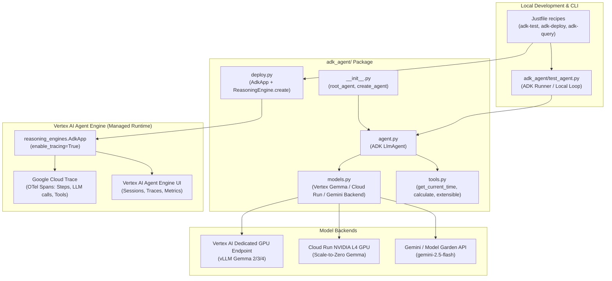

# ADK Agent for Vertex AI Agent Engine with Cloud Tracing

- **Date**: 2026-08-26
- **Status**: Proposed / Approved in Principle
- **Target Component**: `adk_agent/`, `external/adk-python`, `Justfile`

---

## 1. Overview & Objectives

This specification defines the architecture, design, and implementation of a modern Google Agent Development Kit (**ADK**) agent under `adk_agent/` for deployment to **Vertex AI Agent Engine** (`vertexai.preview.reasoning_engines.AdkApp`).

### Primary Goals
1. **Full Observability & Tracing**: Utilize Google ADK's native OpenTelemetry instrumentation and `AdkApp(enable_tracing=True)` to stream granular execution spans (reasoning steps, tool calls, model latency, token metrics) into Google Cloud Trace and the Vertex AI Agent Engine Console.
2. **Explicit Gemma Model Backend Selection**: Provide configurable, explicit model routing allowing targeted testing against specific Gemma model variants (`gemma-2-9b-it`, `gemma-3-4b-it`, `gemma-4-31b-it`, etc.) across Vertex AI Online Prediction dedicated GPU endpoints, Cloud Run serverless GPU services, and Gemini / Vertex Model Garden hosted models.
3. **Bleeding-Edge Source Synchronization**: Include the official `google/adk-python` repository as a submodule under `external/adk-python` for reference, while utilizing `google-adk>=2.7.1` in runtime environments.
4. **Standard CLI & Automation**: Integrate local testing, cloud deployment, and remote querying into the project's root `Justfile`.

---

## 2. System Architecture



---

## 3. Component Details

### 3.1 Submodules (`external/adk-python`, `external/agents-cli`)
* **`external/adk-python`**:
  * **Repository**: `https://github.com/google/adk-python.git`
  * **Role**: Authoritative upstream ADK Python SDK source reference and examples.
* **`external/agents-cli`**:
  * **Repository**: `https://github.com/google/agents-cli.git`
  * **Role**: Official Google Agents CLI for scaffolding, evaluation, and cloud deployment tooling.

### 3.2 ADK Agent Core (`adk_agent/agent.py`)
* Uses `google.adk.agents.LlmAgent` (or `google.adk.Agent`).
* Encapsulates:
  * **System Instruction**: Explicit prompt tailored for Gemma reasoning and tool usage.
  * **Tools**: Python callables registered with type annotations and docstrings.
  * **Model**: Instantiated backend provider from `adk_agent/models.py`.

### 3.3 Model Adapter Layer (`adk_agent/models.py`)
Explicitly configures the LLM provider based on target settings:
* **`vertex_gemma`**: Connects via Vertex AI Prediction / Google Cloud AI Platform to a specified dedicated endpoint (`ENDPOINT_ID` or resolved by flavor name).
* **`cloudrun_gemma`**: Connects via HTTPS to an authenticated Cloud Run GPU service URL.
* **`gemini`**: Connects to `gemini-2.5-flash` or Vertex Model Garden hosted models.

### 3.4 Tools (`adk_agent/tools.py`)
* `get_current_time()`: Returns UTC timestamp.
* `calculate(expression)`: Safe math evaluator.
* Extensible structure allowing import of SOC triage tools or custom domain functions.

### 3.5 Deployment Engine (`adk_agent/deploy.py`)
* Wraps the instantiated agent with `vertexai.preview.reasoning_engines.AdkApp`:
  ```python
  from vertexai.preview import reasoning_engines
  from adk_agent.agent import create_agent

  agent_instance = create_agent(
      flavor=FLAVOR,
      backend=BACKEND,
  )

  adk_app = reasoning_engines.AdkApp(
      agent=agent_instance,
      enable_tracing=True,
  )

  remote_agent = reasoning_engines.ReasoningEngine.create(
      reasoning_engine=adk_app,
      requirements=requirements,
      display_name=f"gemma-adk-{FLAVOR}",
      description="ADK Agent powered by Gemma with Cloud Tracing enabled.",
      extra_packages=["./adk_agent"],
  )
  ```

### 3.6 Local Runner (`adk_agent/test_agent.py`)
* Executes prompt queries locally using ADK `Runner` or direct agent calls.
* Prints step-by-step tool invocations and final responses.
* Verifies compatibility before pushing to Agent Engine.

---

## 4. Dependencies & Container Requirements (`adk_agent/requirements.txt`)

```text
google-adk>=2.7.1
google-cloud-aiplatform>=1.70.0
google-genai>=2.19.0
opentelemetry-api>=1.20.0
opentelemetry-sdk>=1.20.0
requests>=2.31.0
pydantic>=2.0.0
```

---

## 5. Justfile Automation

Add the following recipes to `Justfile`:
```makefile
# Test ADK Agent locally against explicit Gemma model flavor or Gemini
adk-test PROMPT="Explain quantum computing in two concise sentences." FLAVOR="gemma-2-9b-it" BACKEND="vertex_gemma":
    @uv run python3 -m adk_agent.test_agent "{{PROMPT}}" --flavor "{{FLAVOR}}" --backend "{{BACKEND}}"

# Deploy ADK Agent with Tracing enabled to Vertex AI Agent Engine
adk-deploy FLAVOR="gemma-2-9b-it" BACKEND="vertex_gemma":
    @uv run python3 -m adk_agent.deploy --flavor "{{FLAVOR}}" --backend "{{BACKEND}}"

# Query deployed ADK Agent Engine resource
adk-query PROMPT="What is the current UTC time?" RESOURCE="":
    @uv run python3 -m adk_agent.test_agent "{{PROMPT}}" --remote {{if RESOURCE != "" { "--resource " + RESOURCE } else { "" }}}
```

---

## 6. Future Improvements

### Dynamic Gemma Endpoint Discovery Adapter
* In future iterations, develop an ADK-native Model Adapter that scans GCP regions for active `gemma*` Vertex AI dedicated endpoints or Cloud Run services at runtime.
* When active GPU instances are found, route traffic to them; when endpoints are scaled down ($0 idle cost), gracefully fallback to Gemini / Model Garden endpoints with zero user configuration.
