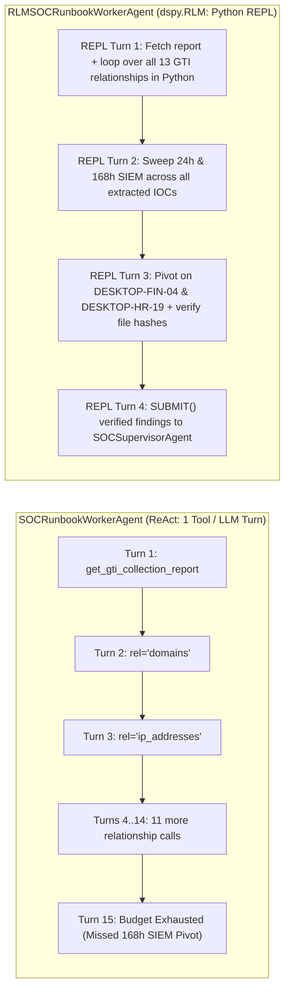

# Recursive Language Models (`dspy.RLM`) in the SOC: When a Python REPL Beats ReAct (and When It Over-Pivots)

**Author:** Dan Dye  
**Date:** October 2026  
**Series:** Serving Open Models for Security & Cloud Agents  
**Repository:** [github.com/dandye/open-model-deploy-gcp](https://github.com/dandye/open-model-deploy-gcp) ([Issue #23](https://github.com/dandye/open-model-deploy-gcp/issues/23), [PR #24](https://github.com/dandye/open-model-deploy-gcp/pull/24))  
**Topics:** Google SecOps, DSPy, Recursive Language Models (RLM), ReAct, Threat Hunting, Gemini, Harness^2, Agent Evaluation  

---

In the [previous post in this series](gepa_runbook_evolution_and_disciplined_hillclimbing.md), I showed how adapting **$\text{Harness}^2$: Recursive Agent Harnessing for an Open World** by Ruiyao Xu, Yanfei Chen, Zhongying CuiZhu, Bhavana Dalvi Mishra, Yifei Ming, Han Yu, Rujun Han, Chen-Yu Lee, and Tomas Pfister at Northwestern University and Google Cloud AI Research (`arXiv:2610.14224`, [github.com/google-research/harness2](https://github.com/google-research/harness2)) allowed me to evolve compact, high-compliance Security Operations Center (SOC) runbooks offline. By separating workflow (`INVARIANT`) edits from practitioner (`DOMAIN`) rules and enforcing categorical safety gates inside the inner probe, $\text{Harness}^2$ compressed our four Tier 1 triage playbooks by `52.2%` (`3,648 -> 1,743` words) and reduced 3-model operational loss by `89.1%`.

Yet one result from our Track 2 Proactive Threat Hunting benchmark (`ThreatHuntEnvironment`, modeled on the *Unwrapping Ursnif's Gifts* campaign in Google Threat Intelligence and Google SecOps Chronicle SIEM) bothered me.

When I ran `gemini-2.5-flash-lite` and `gemini-2.5-flash` with the raw, unstripped `892`-word community threat-hunting runbook (`raw_clinerules_hunt`, derived from Google's [`google/mcp-security`](https://github.com/google/mcp-security) `ai-runbooks`), both models failed to find Patient Zero (`DESKTOP-FIN-04` / `malwaretest-win`). `gemini-2.5-flash-lite` scored `0.5200` Hunt Composite, and `gemini-2.5-flash` scored `0.3300` (`INCONCLUSIVE`), spending `184.60` seconds before exhausting its `15`-step turn budget.

Why did a frontier Flash model run out of turns on a 6-hop threat hunt?

Because the raw `.clinerules` runbook instructs the analyst to query **all 13 Google Threat Intelligence (GTI) collection relationship descriptors**:

> `attack_techniques`, `campaigns`, `collections`, `comments`, `contacted_domains`, `contacted_ips`, `domains`, `dropped_files`, `execution_parents`, `files`, `ip_addresses`, `malware_families`, `threat_actors`

In a standard **ReAct** loop (Yao et al., 2023, *ReAct: Synergizing Reasoning and Acting in Language Models*, Princeton & Google Research, `arXiv:2210.03629`), the worker emits **one JSON tool call per LLM turn**. Enumerating 13 GTI relationship types one turn at a time consumes 13 consecutive LLM round-trips before the agent ever queries Chronicle SIEM. By the time the ReAct worker finishes reading GTI relationships, it hits `max_iterations = 15`, never widens the SIEM search window from `24h` to `168h`, and misses the compromised Finance workstation completely.

Offline runbook evolution ($\text{Harness}^2$) fixed that problem by pruning the markdown text down to the four highest-signal relationship types (`domains`, `ip_addresses`, `files`, `attack_techniques`). Still, pruning a list in a prompt felt like a workaround for an architectural limitation in ReAct itself. If a human detection engineer needs to check 13 GTI relationship types and sweep 20 IOCs across two SIEM time windows, they do not manually type 35 sequential curl commands one at a time—they write a `for` loop.

That observation led me to [GitHub Issue #23](https://github.com/dandye/open-model-deploy-gcp/issues/23): replacing the single-step ReAct worker inside `SOCSupervisorAgent` with DSPy's **`dspy.RLM` (Recursive Language Model)** module (`dspy>=3.4.1`, [dspy.ai/current/api/modules/RLM/](https://dspy.ai/current/api/modules/RLM/)), based on Alex L. Zhang, Tim Kraska, and Omar Khattab's paper *Recursive Language Models* (`arXiv:2512.24601`).

This post covers how I built `RLMSOCRunbookWorkerAgent` and `GuardedSOCInterpreter` (`agent/rlm_soc_worker.py`), what broke when I first turned a Python REPL loose on our 10-case Gen 3 Tier 1 triage suite, how `dspy.RLM` cut 6-hop threat-hunting latency by **`57.5%` (`2.35x` speedup)** while rescuing the unstripped 13-relationship runbook (`0.3300 -> 1.0000` Hunt Composite, **`5.05x` faster**), and where this work goes next.

---

## 1. Background: From ReAct and CodeAct to Recursive Language Models (`dspy.RLM`)

To understand what `dspy.RLM` changes in a security agent, it helps to trace three generations of tool-use architectures:

1. **JSON ReAct (Yao et al., 2023, Princeton & Google Research, `arXiv:2210.03629`)**: At each step $t$, the model generates a `Thought` and a single structured `Action: {"name": tool, "arguments": {...}}`. The harness executes the tool and appends the stringified `Observation` directly to the conversation history. Every tool call costs one full LLM prefill-and-decode pass, and every returned JSON payload accumulates in the prompt context.
2. **Executable Code Actions (`CodeAct`, Wang et al., 2024, `arXiv:2402.01030`)**: Instead of emitting JSON tool calls, the model writes executable Python code blocks that can call multiple tools in sequence or inside a loop (`for ioc in iocs: ...`).
3. **Recursive Language Models (`RLM`, Zhang, Kraska, & Khattab, 2025, `arXiv:2512.24601`; Khattab et al., 2024, *DSPy*, `arXiv:2310.03714`)**: Zhang, Kraska, and Khattab generalize code-action loops into a recursive inference paradigm. Instead of stuffing massive contexts or raw tool outputs into the root LLM's attention window, `dspy.RLM` mounts both the input variables and external tools inside a persistent sandboxed Python interpreter (`LocalInterpreter`). The root LLM writes Python code to slice, regex-filter, aggregate, and join large observations in native Python memory, printing only compact summaries back into its own trajectory—and when semantic reasoning is needed over a slice of data, the Python code can recursively invoke `llm_query(prompt)` or `llm_query_batched(prompts)` against a designated `sub_lm` before terminating with a typed `SUBMIT(...)` call.

In a SOC workflow, this distinction maps directly onto the difference between **Tier 1 single-alert enrichment** and **Track 2 multi-hop threat hunting**:



---

## 2. Architecture: Building `RLMSOCRunbookWorkerAgent` and `GuardedSOCInterpreter`

In our hierarchical SOC architecture (`agent/hierarchical_soc_agent.py`), `SOCSupervisorAgent` enforces a hard privilege boundary between **epistemic investigation** (worker) and **destructive containment** (supervisor):

1. The supervisor classifies the incoming alert (`C2_BEACON`, `PHISHING_DOMAIN`, `SUSPICIOUS_LOGIN`, `MALWARE_HASH`, `LATERAL_MOVEMENT`, or `THREAT_HUNT`) and loads the corresponding runbook (`strip_runbook_scaffolding()`).
2. The worker executes read-only SIEM, SOAR, CMDB, and GTI tools to gather evidence and returns a structured `WorkerInvestigationReport` (`target_entities`, `risk_level`, `evidence`, `raw_response`).
3. Only after `_has_investigation_evidence(worker_trajectory)` confirms that real epistemic tools were executed does `SOCSupervisorAgent` synthesize a final `SocDecision` and deterministically execute containment actions (`isolate_host`, `block_indicator`, `close_case`, `update_case_comment`).

Additionally, to preserve benchmark integrity (following the regularization discipline from **RRSI: Regularized Recursive Self-Improvement of Agent Harnesses** by Peng Xia et al. at Google Cloud AI Research, `arXiv:2609.24972`), our repository locks 33 core evaluation and scoring files—including `scripts/eval_soc_agent.py`—via SHA-256 checksums in `.eval_harness_lock.json`.

To integrate `dspy.RLM` without touching any of the 33 locked files, I implemented `RLMSOCRunbookWorkerAgent` in `agent/rlm_soc_worker.py` and wired it into `SOCSupervisorAgent` via `worker_mode="react" | "rlm" | "auto"` (and the `SOC_WORKER_MODE` environment variable).

### 2.1 Why Standard `dspy.LocalInterpreter` Needed `GuardedSOCInterpreter`

Out of the box, `dspy.RLM(signature, interpreter=..., tools=...)` lets the model call `SUBMIT(...)` whenever its Python code decides it is done. During initial testing, I discovered two ways an unguarded REPL breaks SOC epistemic guarantees:

- **Zero-Tool Premature `SUBMIT()`**: A compact model can write `SUBMIT(target_entities=[...], risk_level="MALICIOUS", ...)` on REPL Turn 1 without calling a single tool.
- **Same-Turn Blind `SUBMIT()` (Rule 6 Violation)**: Even more subtle, a model writing Python code can call a tool and call `SUBMIT()` in the **same REPL code block**:
  ```python
  # UNSAFE: The LLM never sees the real return value of lookup_entity() before submitting!
  host = lookup_entity(entity_id="DESKTOP-FIN-08", entity_type="host")
  SUBMIT(
      target_entities=["DESKTOP-FIN-08"],
      risk_level="MALICIOUS",  # Hardcoded guess before observing `host`!
      findings_summary=f"Host info: {host}",
      evidence_items=[str(host)],
  )
  ```
  If the model calls `lookup_entity()` and `SUBMIT()` in the same turn, the Python variable `host` is interpolated into `evidence_items`, but the LLM chose `risk_level="MALICIOUS"` *before* inspecting what `lookup_entity()` returned.

To make both failure modes structurally impossible, I subclassed `dspy.primitives.local_interpreter.LocalInterpreter` (which runs an isolated `python -I` subprocess) to create **`GuardedSOCInterpreter`**. Whenever the executed Python block returns a `FinalOutput` (triggered by `SUBMIT(...)`), `GuardedSOCInterpreter.execute()` checks four invariants and raises a `CodeExecutionError` back into the REPL if any invariant fails:

1. **Guard 1 (Non-Empty Epistemic Trajectory)**: `len(recorded_trajectory) > 0`. Rejects `SUBMIT()` if no epistemic tool was called.
2. **Guard 2 (Rule 6 Observe-Before-Submit)**: Compares `len(recorded_trajectory)` at the start and end of `super().execute(code, variables)`. If new tool calls were recorded in the *same* REPL step that called `SUBMIT()`, `GuardedSOCInterpreter` raises a `CodeExecutionError` instructing the agent to `print()` the tool outputs first and call `SUBMIT()` on the next REPL turn after inspecting them.
3. **Guard 3 (HTTP 503 Degraded Telemetry Fallback)**: If an upstream GTI tool returned HTTP `503` (`Service Unavailable`), requires the worker to pivot to local SIEM/SOAR telemetry (`lookup_entity`, `query_siem_events`, or `list_cases`) before accepting `SUBMIT()`.
4. **Guard 4 (Proactive Threat-Hunt Local SIEM Check)**: When `classification == "THREAT_HUNT"`, requires at least one internal SIEM/SOAR tool call (`search_security_events`, `get_ioc_matches`, `query_siem_events`, `lookup_entity`, or `list_cases`) in addition to external GTI collection queries before `SUBMIT()`.

### 2.2 Call Deduplication & Untruncated Observation Bridging

When an LLM writes multi-turn Python scripts in a REPL, it occasionally re-runs an earlier lookup (`lookup_entity("SRV-PROD-PAYMENT-01")`) while refining a filter. In `RLMSOCRunbookWorkerAgent._build_epistemic_tools()`, I added a per-investigation `(tool_name, canonical_args_json)` cache (`seen_tool_calls`). If the REPL calls an identical read-only tool a second time, the wrapper returns the cached Python dictionary immediately without appending a duplicate step to `worker_trajectory`. And unlike our ReAct worker (which truncates `evidence` snippets to `600` characters per step), `RLMSOCRunbookWorkerAgent` forwards up to `8,000` characters per observation (`max_finding_chars = 8000`) so full multi-event JSON payloads remain intact.

---

## 3. Experiment 1: Gen 3 10-Case Tier 1 Triage and the REPL Over-Pivoting Discovery

I first tested `RLMSOCRunbookWorkerAgent` against `SOCRunbookWorkerAgent` on the locked 10-case Gen 3 Interactive SOC Tier 1 suite (`configs/evals/gen3/soc_tier1_interactive.json`) using our $\text{Harness}^2$-evolved runbooks (`configs/runbooks/harness2_evolved`) and the calibrated System-One `jev` judge (`--judge-backend jev`).

### 3.1 Gen 3 Aggregate Scorecard (`10` Cases per Arm)

| Metric | `gemini-2.5-flash-lite` (ReAct Baseline) | `gemini-2.5-flash-lite` (Unscoped RLM v1) | `gemini-2.5-flash-lite` (Scoped RLM v2) | `gemini-2.5-flash` (Scoped RLM v2) |
| :--- | :---: | :---: | :---: | :---: |
| **Mean Harbor 60/20/20 Reward** | **`0.9801`** | `0.9194` | `0.9553` | `0.9665` |
| **Mean Rubric Score (Jev)** | `83.0 / 100` (`60%` pass) | `69.0 / 100` (`50%` pass) | `81.0 / 100` (`40%` pass) | **`84.0 / 100`** (`60%` pass) |
| **SDT Sensitivity ($d'$)** | **`2.43`** | `1.90` | **`2.43`** | **`2.43`** |
| **SDT Criterion Bias ($c$)** | `-0.25` | `-0.51` | `-0.25` | `-0.25` |
| **Pragmatic Action Match Rate** | **`100.0%` (`10/10`)** | `90.0%` (`9/10`) | **`100.0%` (`10/10`)** | **`100.0%` (`10/10`)** |
| **False Positive Blast-Radius Loss** | **`\$0.00`** | `\$50,000.00` (sim) | **`\$0.00`** | **`\$0.00`** |
| **False Negative Breach Loss** | **`\$0.00`** | **`\$0.00`** | **`\$0.00`** | **`\$0.00`** |
| **Total Expected Operational Loss** | **`\$0.39`** | `\$50.69` | `\$0.82` | `\$0.54` |
| **Mean Latency per Case** | `20.46 s` | `18.11 s` | **`18.00 s`** (`-12.0%`) | `30.28 s` |
| **Mean Tokens per Case** | **`16,809`** | `31,107` | `37,304` | `23,774` |
| **Total Tool Invocations (10 cases)** | **`52`** | `69` | `70` | `64` |
| **Epistemic Step Efficiency** | **`1.00`** | `0.95` | `0.90` | `0.96` |

### 3.2 What Happened in `CASE-GEN3-06`? Programmatic Over-Pivoting in Shared SIEM State

Look at the second column (`Unscoped RLM v1`): Harbor 60/20/20 dropped to `0.9194` because `CASE-GEN3-06-AMBIGUOUS-DNS-TUNNEL` scored `0.456` and incurred a **`\$50,000` false-positive isolation penalty**.

When I inspected the REPL trajectory in `docs/soc_eval_results/gen3/gemini_2_5_flash_lite_rlm_spike.json`, I found a fascinating interaction between `dspy.RLM`'s programmatic curiosity and shared SIEM sandbox state:

1. In `CASE-GEN3-06`, the alert asks the analyst to investigate high-entropy DNS TXT queries from `SRV-PROD-PAYMENT-01` (`10.0.10.50`) to `telemetry-sync-cdn.net` (`CASE-55102`). Because `telemetry-sync-cdn.net` has an ambiguous GTI reputation (`SUSPICIOUS`, confidence `35/100`) and `SRV-PROD-PAYMENT-01` is a `CRITICAL` payment server, the runbook requires rendering `SUSPICIOUS` and **withholding `isolate_host`**.
2. In `SocEnvironment._entity_lookup` (`agent/soc_environment.py`), calling `lookup_entity("SRV-PROD-PAYMENT-01", "host")` returns a JSON dictionary containing all recent SIEM events across the shared 10-case sandbox—including an outbound connection to `"destination_ip": "198.51.100.42"` at **character offset `~720`** (which belongs to `CASE-GEN3-01` / `CASE-GEN3-05`).
3. Why did our ReAct worker never trip over byte `~720`? Because `SOCRunbookWorkerAgent` truncated each step's `evidence` summary to `600` characters (`obs[:600]`) and only queried indicators named in the alert prompt (`telemetry-sync-cdn.net`).
4. Why did Unscoped `dspy.RLM` trip over it? Because in Python, iterating over a dictionary is effortless. The RLM worker wrote Python code to inspect `host_info["recent_siem_events"]`, saw `"destination_ip": "198.51.100.42"`, and decided to enrich `198.51.100.42` via `get_ip_report("198.51.100.42")` and `list_cases(query="198.51.100.42")`. When GTI returned `MALICIOUS` (`Lokibot C2`, `confidence: 98`) and `CASE-33279`, the worker reported `SRV-PROD-PAYMENT-01` as actively compromised by Lokibot and isolated the production payment server!

In other words, **giving an unconstrained Python REPL to a Tier 1 alert worker turned a single-indicator triage task into an unscoped host-wide fishing expedition.**

### 3.3 Fixing Over-Pivoting with Alert-Scope Discipline (`Scoped RLM v2`)

I fixed this in `agent/rlm_soc_worker.py` with three targeted changes:

1. **Alert-Scope Pivot Rule in `SOCRLMInvestigationSignature`**: For single-alert Tier 1 triage (`classification != "THREAT_HUNT"`), the worker is instructed to enrich only the primary indicators named in `alert_prompt` (plus authorized-scanner or active-change-window explanations for that specific traffic) rather than pivoting to unrelated historical IPs or background alerts on shared infrastructure.
2. **Prompt-Scoped `CASE-...` Normalization (`normalize_rlm_entities`)**: When extracting SOAR case IDs from `target_entities`, non-`THREAT_HUNT` runs retain `CASE-XXXXX` IDs only if they match the case referenced in `alert_prompt` (or when no case ID was specified in the prompt), preventing cross-case `list_cases` inventory pollution.
3. **Risk Alias Normalization (`normalize_rlm_risk_level`)**: Mapped `"CLEAN"` and `"SAFE"` to `"BENIGN"` so `CASE-GEN3-02-RFC5737-BENIGN-IP` no longer fell through to `"INCONCLUSIVE"`.

With those three fixes (`Scoped RLM v2`):
- False-positive blast-radius loss dropped from **`\$50,000` to `\$0.00`** on both `gemini-2.5-flash-lite` and `gemini-2.5-flash`.
- Pragmatic, operator, and advisor action compliance reached **`100.0%` (`10/10`)** on both models with $d' = 2.43$.
- `gemini-2.5-flash-lite` Scoped RLM ran **`12.0%` faster** than ReAct (`18.00s` vs. `20.46s`, `0.9553` Harbor), and `gemini-2.5-flash` Scoped RLM achieved **`0.9665` Harbor 60/20/20** and a higher average Jev rubric score (**`84.0 / 100`**) than the ReAct baseline (`83.0 / 100`).

Even so, Experiment 1 shows why ReAct remains the right default for simple Tier 1 alerts: when an alert only requires 3–5 tool calls, `dspy.RLM`'s Python REPL system prompt adds `~7,000 - 20,000` extra prompt tokens per case (`23.8k - 37.3k` vs. `16.8k`) without beating ReAct's `0.9801` Harbor score.

---

## 4. Experiment 2: Track 2 6-Hop Proactive Threat Hunting (`HUNT-URSNIF-COLLECTION-01`)

When I moved `RLMSOCRunbookWorkerAgent` from 3-step Tier 1 alerts to **Track 2 6-Hop Proactive Threat Hunting** (`HUNT-URSNIF-COLLECTION-01` in `configs/evals/hunt/ursnif_gti_hunt_suite.json`), the tradeoff flipped completely in `dspy.RLM`'s favor.

In `HUNT-URSNIF-COLLECTION-01`, the analyst receives a single seed collection ID (`alienvault_63bbee81b55c8ba00724605a`, *Unwrapping Ursnif's Gifts*) and must:
1. Pull the GTI collection report (`get_collection_report`).
2. Enumerate related indicators across the GTI knowledge graph (`get_entities_related_to_a_collection`).
3. Pivot from domains to resolved IPs (`get_entities_related_to_a_domain` on `superstarts.top` -> `193.106.191.163`).
4. Sweep internal IOC matches and Chronicle SIEM events (`get_ioc_matches`, `search_security_events`) at the default `72h` window—discovering that only a benign IT maintenance script (`rundll32.exe`, `7d99c80a...` `123.com`) and an Nginx healthcheck (`38ffd143...` `index.html`) fired in the last 72 hours.
5. **Widen the SIEM time horizon from `72h` to `168h` (`time_range_hours=168`)** after the `72h` window yields zero confirmed Ursnif compromises.
6. Identify Patient Zero (`malwaretest-win`, `10.10.40.18`), correlate the unalerted SOAR ticket (`CASE-2396`), block the malicious Ursnif indicators (`superstarts.top`, `193.106.191.163`, `dfdfd0a3...`, `8e570e32...`), isolate `malwaretest-win`, and **refrain from blocking** the signed Microsoft LOLBin (`7d99c80a...`).

I evaluated ReAct vs. `dspy.RLM` across two runbook arms:
- **Arm 1 (`harness2_evolved`)**: Our `347`-word $\text{Harness}^2$-evolved runbook (`configs/runbooks/harness2_evolved/gti_collection_threat_hunt.md`), which pre-filters the GTI relationship list to 4 descriptors.
- **Arm 2 (`raw_clinerules_hunt`)**: The unstripped `892`-word `.clinerules` runbook, which lists all 13 GTI relationship descriptors.

### 4.1 Track 2 Threat-Hunt Results (`HUNT-URSNIF-COLLECTION-01`)

| Model | Runbook Arm | Worker Mode | Hunt Composite | Harbor 60/20/20 | Widened `168h` | Patient Zero Isolated (`malwaretest-win`) | LOLBin Safe | Verdict | Tool Calls (REPL Steps) | Wall-Clock Latency |
| :--- | :--- | :---: | :---: | :---: | :---: | :---: | :---: | :---: | :---: | :---: |
| `gemini-2.5-flash-lite` | `harness2_evolved` (`347`w) | **ReAct** | **`1.0000`** | `0.9360` | `True` | `True` | `True` | `MALICIOUS` | `11` (`11` turns) | `60.72 s` |
| `gemini-2.5-flash-lite` | `harness2_evolved` (`347`w) | **DSPy `RLM`** | **`1.0000`** | `0.9200` | `True` | `True` | `True` | `MALICIOUS` | `18` (**`5` REPL turns**) | **`25.81 s` (`-57.5%` / `2.35x` faster)** |
| `gemini-2.5-flash-lite` | `raw_clinerules_hunt` (`892`w) | **ReAct** | `0.5200` | `0.7850` | **`False`** | **`False`** | `True` | `MALICIOUS` | `16` (`15` turns, budget exhausted) | `43.25 s` |
| `gemini-2.5-flash-lite` | `raw_clinerules_hunt` (`892`w) | **DSPy `RLM`** | **`1.0000`** (`+0.4800`) | **`0.9200`** | **`True`** | **`True`** | **`True`** | `MALICIOUS` | `24` (**`8` REPL turns**) | **`34.91 s`** |
| `gemini-2.5-flash` | `raw_clinerules_hunt` (`892`w) | **ReAct** | `0.3300` | `0.4590` | **`False`** | **`False`** | `True` | `INCONCLUSIVE` | `15` (`15` turns, budget exhausted) | `184.60 s` |
| `gemini-2.5-flash` | `raw_clinerules_hunt` (`892`w) | **DSPy `RLM`** | **`1.0000`** (`+0.6700`) | **`0.9680`** | **`True`** | **`True`** | **`True`** | `MALICIOUS` | `9` (**`6` REPL turns**) | **`36.54 s` (`-80.2%` / `5.05x` faster)** |

### 4.2 Inside the `dspy.RLM` Threat-Hunt Trajectory

Here is how `RLMSOCRunbookWorkerAgent` solved both the latency bottleneck on `harness2_evolved` and the turn-budget exhaustion on `raw_clinerules_hunt`:

1. **Batching 13 Relationship Lookups in a Single Python Loop**: When given the unstripped `892`-word `raw_clinerules_hunt` runbook, `gemini-2.5-flash-lite` wrote a Python `for` loop in REPL Turn 1 that iterated across the relationship descriptors (`files`, `domains`, `ip_addresses`, `contacted_domains`, `contacted_ips`, `dropped_files`, `execution_parents`, `attack_techniques`, `campaigns`, `threat_actors`, `malware_families`), filtering out empty responses in Python memory and printing only the populated IOC lists. What took ReAct 13 sequential LLM turns took `dspy.RLM` **1 turn**.
2. **Programmatic `72h -> 168h` Horizon Widening**: In REPL Turns 2–4, the RLM worker queried `get_ioc_matches(time_range_hours=72)` and looped `search_security_events(..., time_range_hours=72)` over the discovered Ursnif hashes and IPs. Seeing that the `72h` window returned only the signed `rundll32.exe` LOLBin on `wkstn-fin-04` and benign `index.html` on `srv-web-02`, the Python script immediately looped `search_security_events(..., time_range_hours=168)` across all Ursnif IOCs in a single turn—uncovering `malwaretest-win` (`10.10.40.18`), `itsIt.db` (`8e570e32...`), `superstarts.top`, and `193.106.191.163`.
3. **Speed and Reliability**:
   - On `harness2_evolved`, `dspy.RLM` executed `18` tool calls across just **`5` REPL turns** in **`25.81s`**—cutting wall-clock latency by **`57.5%` (`2.35x` speedup)** compared to ReAct's `60.72s` (`11` turns).
   - On `raw_clinerules_hunt`, `dspy.RLM` lifted `gemini-2.5-flash-lite` from `0.5200` to **`1.0000`** (`34.91s`) and lifted `gemini-2.5-flash` from `0.3300` (`INCONCLUSIVE`, `184.60s`) to **`1.0000` Hunt Composite / `0.9680` Harbor 60/20/20 in `36.54s` (`5.05x` faster)**.

---

## 5. Incorporating the Findings into Production: Hybrid `worker_mode="auto"`

The experiments in Track 1 and Track 2 point to a clean architectural division of labor:

- **Shallow, single-indicator Tier 1 alerts (`3-5` tool calls)** belong on **ReAct (`SOCRunbookWorkerAgent`)**: there is no fan-out loop to amortize `dspy.RLM`'s REPL prompt overhead, and single-step ReAct naturally avoids over-pivoting into unrelated historical events on shared hosts.
- **Deep, multi-hop graph traversals and threat hunts (`10-25` tool calls)** belong on **DSPy `RLM` (`RLMSOCRunbookWorkerAgent`)**: Python loops collapse $O(N)$ sequential LLM round-trips into $O(1)$ REPL turns, slashing latency by `57.5% - 80.2%` and making the agent resilient to verbose, unpruned human runbooks.

In [PR #24](https://github.com/dandye/open-model-deploy-gcp/pull/24), I added `_resolve_effective_worker_mode()` to `SOCSupervisorAgent` (`agent/hierarchical_soc_agent.py`):

```python
def _resolve_effective_worker_mode(self, classification: str) -> str:
    mode = (self.worker_mode or "react").strip().lower()
    if mode == "rlm":
        return "rlm"
    if mode == "auto":
        if (
            classification == "THREAT_HUNT"
            or bool(getattr(self.environment, "supports_threat_hunt_tools", False))
        ):
            return "rlm"
        return "react"
    return "react"
```

Setting `worker_mode="auto"` (or `SOC_WORKER_MODE="auto"`) gives `SOCSupervisorAgent` the best of both worlds: single-indicator Tier 1 alerts (`C2_BEACON`, `PHISHING_DOMAIN`, `SUSPICIOUS_LOGIN`, `MALWARE_HASH`, `LATERAL_MOVEMENT`) run on the fast, low-token ReAct worker (`0.9801` Harbor, `16.8k` tok/case), while `THREAT_HUNT` campaigns automatically dispatch to `RLMSOCRunbookWorkerAgent` (`1.0000` Hunt Composite, `2.35x - 5.05x` speedup).

---

## 6. Future Work & Next Experiments

This experiment opens four concrete follow-on tracks in [`open-model-deploy-gcp`](https://github.com/dandye/open-model-deploy-gcp):

1. **Heterogeneous Root-LM + Sub-LM Delegation via `llm_query_batched()`**:
   - One of the core contributions of Zhang, Kraska, and Khattab's RLM paper (`arXiv:2512.24601`) is separating the *root LM* (which writes the Python control flow) from the *sub-LM* (`dspy.RLM(..., sub_lm=...)`, invoked from Python via `llm_query_batched(prompts)`).
   - `RLMSOCRunbookWorkerAgent` already supports `sub_model` / `SOC_RLM_SUB_MODEL`. The next experiment will pair `gemini-2.5-flash` (or `gemini-2.5-pro`) as the root orchestrator with `gemini-2.5-flash-lite` or a self-hosted `gemma-4-e4b-it` endpoint on Cloud Run L4 GPU (`\$0.76/hr`, scale-to-zero) as `sub_lm` to classify batches of raw PowerShell/WMI command lines in parallel inside the REPL.
2. **Open-Weight Gemma 4 & Qwen 3.8 RLM Benchmarking and SFT Distillation**:
   - Now that `RLMSOCRunbookWorkerAgent` works with any OpenAI-compatible or Vertex AI endpoint via `build_vertex_dspy_lm()`, I plan to benchmark `gemma-4-31b-it` (`2x A100`), `qwen3.8-27b` (`1x RTX PRO 6000`), and `nemotron-3.5-super-vl-nvfp4` in `worker_mode="rlm"`, and distill the verified 5-turn Python REPL trajectories from `gemini-2.5-flash` into our balanced SFT dataset (`filter_balanced_traces()`) so compact open-weight models can write multi-hop Python threat-hunting loops without syntax or `SUBMIT()` guard retries.
3. **Joint $\text{Harness}^2$ + `dspy.RLM` Runbook Co-Evolution**:
   - Our existing `harness2_evolved` runbooks were evolved under `SOCRunbookWorkerAgent` (ReAct). Running `Harness2ProposeProbeComposeProposer` (`arXiv:2610.14224`) with `SOC_WORKER_MODE="rlm"` will allow the `INV` (workflow) editor to discover runbook idioms explicitly designed for Python REPL batching (such as set-intersection idioms across GTI relationships and UDM host tables).
4. **Live Google SecOps MCP & High-Volume UDM Telemetry Filtering**:
   - In our synthetic `SocEnvironment`, `query_siem_events` returns compact JSON lists. Against a production Google SecOps (Chronicle) tenant via `secops-mcp`, a single `168h` UDM search can return hundreds of events (`50 KB - 500 KB` of JSON). Benchmarking `RLMSOCRunbookWorkerAgent` on high-volume UDM payloads will test `dspy.RLM`'s primary theoretical advantage: keeping megabytes of raw SIEM logs in Python REPL variables while feeding only filtered `print()` summaries to the LLM.

---

## 7. References & Related Work

1. **Zhang, A. L., Kraska, T., & Khattab, O. (2025).** *Recursive Language Models.* MIT CSAIL & Databricks. `arXiv:2512.24601`. https://arxiv.org/abs/2512.24601 — Introduces the Recursive Language Model (`RLM`) inference paradigm in which an LLM treats external context and tool outputs as state in a Python REPL and invokes recursive `llm_query` sub-calls. Used as the foundation for `RLMSOCRunbookWorkerAgent` and `GuardedSOCInterpreter` in `agent/rlm_soc_worker.py`.
2. **Khattab, O., Singhvi, A., Maheshwari, P., Zhang, Z., Santhanam, K., Vardhamanan, S., Haq, S., Sharma, A., Joshi, T. T., Moazam, H., Miller, H., Zaharia, M., & Potts, C. (2024).** *DSPy: Compiling Declarative Language Model Calls into Self-Improving Pipelines.* ICLR 2024. `arXiv:2310.03714`. Module documentation: `https://dspy.ai/current/api/modules/RLM/` — Provides the `dspy.RLM` module, `LocalInterpreter`, and typed `Signature` / `SUBMIT()` primitives used in `dspy>=3.4.1`.
3. **Xu, R., Chen, Y., CuiZhu, Z., Dalvi Mishra, B., Ming, Y., Yu, H., Han, R., Lee, C.-Y., & Pfister, T. (2026).** *$\text{Harness}^2$: Recursive Agent Harnessing for an Open World.* Northwestern University & Google Cloud AI Research. `arXiv:2610.14224`. https://arxiv.org/abs/2610.14224 (`https://github.com/google-research/harness2`, `https://harness2.github.io`) — Used to evolve the `configs/runbooks/harness2_evolved/` runbook suite compared against `raw_clinerules_hunt` in Experiments 1 and 2 ([`HARNESS2_CAMPAIGN_REPORT.md`](../soc_eval_results/harness2_8h_campaign/HARNESS2_CAMPAIGN_REPORT.md)).
4. **Xia, P., Han, R., Wang, Z., Chen, Y., Zhuang, Y., Lee, Y., Huang, C., Yu, H., CuiZhu, Z., Ming, Y., Yao, H., Gokturk, B., Pfister, T., & Lee, C.-Y. (2026).** *RRSI: Regularized Recursive Self-Improvement of Agent Harnesses.* Google Cloud AI Research. `arXiv:2609.24972`. https://arxiv.org/abs/2609.24972 — Provides the regularization and harness-integrity framework behind `.eval_harness_lock.json` and our categorical safety gates ([`hillclimber_rrsi_crosswalk.md`](../hillclimber_rrsi_crosswalk.md)).
5. **Yao, S., Zhao, J., Yu, D., Du, N., Shafran, I., Narasimhan, K., & Cao, Y. (2023).** *ReAct: Synergizing Reasoning and Acting in Language Models.* Princeton University & Google Research. ICLR 2023. `arXiv:2210.03629`. https://arxiv.org/abs/2210.03629 — The single-step reasoning-and-acting loop implemented in `SOCRunbookWorkerAgent` (`worker_mode="react"`) and evaluated as the baseline in Experiments 1 and 2.
6. **Wang, X., Chen, Y., Yuan, L., Zhang, Y., Li, Y., Peng, H., & Ji, H. (2024).** *Executable Code Actions Elicit Better LLM Agents (`CodeAct`).* ICML 2024. `arXiv:2402.01030`. https://arxiv.org/abs/2402.01030 — Demonstrates that executable Python actions allow LLM agents to compose multiple tool calls and control-flow loops in a single turn.
7. **Agrawal, L. A., et al. (2025).** *GEPA: Reflective Prompt Evolution Can Outperform Reinforcement Learning.* `arXiv:2507.19457`. https://arxiv.org/abs/2507.19457 — The reflective prompt optimizer wrapped in `agent/gepa_runbook_optimizer.py`.
8. **Google Security Operations & Google Threat Intelligence (`google/mcp-security`).** `https://github.com/google/mcp-security` — Source of the community `.clinerules` SecOps runbooks (`third_party/ai-runbooks`) and the `secops-mcp`, `gti-mcp`, and `secops-soar-mcp` tool schemas modeled in `SocEnvironment` and `ThreatHuntEnvironment`.

### Companion Documents in This Repository
- [`docs/soc_eval_results/DSPY_RLM_WORKER_EVALUATION_ANALYSIS.md`](../soc_eval_results/DSPY_RLM_WORKER_EVALUATION_ANALYSIS.md): Full structured evaluation scorecard, per-case Gen 3 breakdown, Track 2 threat-hunt tables, and reproducibility commands.
- [`docs/blog/gepa_runbook_evolution_and_disciplined_hillclimbing.md`](gepa_runbook_evolution_and_disciplined_hillclimbing.md): Companion post on GEPA, verbosity bias, disciplined hillclimbing, and $\text{Harness}^2$ recursive runbook evolution.
- [`docs/soc_eval_results/harness2_8h_campaign/HARNESS2_CAMPAIGN_REPORT.md`](../soc_eval_results/harness2_8h_campaign/HARNESS2_CAMPAIGN_REPORT.md): The 8-hour $\text{Harness}^2$ campaign report and 228-trajectory cross-model transfer scorecards.
