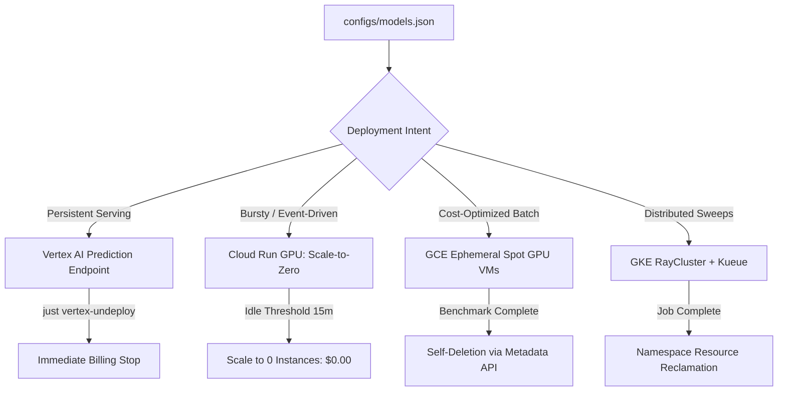
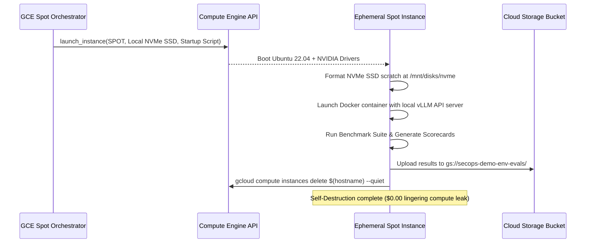

# Deploying Gemma at Scale, Part 1: The Zero-Idle GPU Blueprint — Sizing, Serving, and Ephemeral Cloud Infrastructure

**Author:** Dan Dye  
**Series:** Deploying Gemma at Scale (Part 1 of 3)  
**Topics:** Google Cloud Platform, Gemma 2/3/4, vLLM, Cloud Run GPU, Vertex AI, GCE Spot VMs, Infrastructure as Code  

---

## 1. Introduction: The Enterprise LLM Serving Dilemma

Deploying generative AI models in enterprise environments presents an immediate operational conflict: availability versus economics.

When serving frontier foundation models like Gemini 2.5 Pro via managed APIs, organizations benefit from elastic, zero-maintenance capacity. However, they forfeit data residency control, accept opaque per-token rate structures, and face compounding costs when autonomous agents generate millions of reasoning tokens during multi-step tool investigations. Conversely, deploying open-weight models—such as Google's Gemma family—provides complete control over weights, execution environments, and internal security boundaries.

The pitfall lies in conventional deployment patterns: provisioning persistent, dedicated GPU virtual machines (e.g., `g2-standard-8` with an NVIDIA L4 GPU or `a2-highgpu-2g` with 2x NVIDIA A100s) that sit idle 80% to 90% of the day. At standard cloud list prices, an idle single-L4 instance costs roughly $600 to $800 per month, while a 4x L4 or 2x A100 node costs between $2,400 and $4,500 per month—accumulating billing waste whether processing inferences or doing nothing.

In the **`gemma_deploy`** project, we designed and implemented a multi-substrate cloud architecture on Google Cloud Platform (GCP) engineered around a single mandate: **guaranteed zero idle compute waste ($0.00 idle cost)** without sacrificing operational readiness or throughput.

This first installment of our three-part series examines:
* The hardware sizing taxonomy across three generations of Gemma (Gemma 2, 3, and 4).
* The centralized declarative catalog unifying Infrastructure as Code (Terraform) and shell automation.
* How to orchestrate four distinct compute substrates on GCP: Vertex AI Prediction, Serverless Cloud Run with GPU, Ephemeral GCE Spot GPU VMs with automated self-deletion, and GKE Ray Clusters with Kueue.
* Operational tooling that enforces absolute resource hygiene.

---

## 2. Multi-Model Hardware Sizing Taxonomy

Serving large language models requires balancing memory footprints across four competing demands:
1. **Model Weights**: Base parameters loaded into VRAM.
2. **KV Cache**: Key-value activations stored across multi-turn context windows.
3. **Activation Memory**: Scratch space required during forward prefill and autoregressive decoding passes.
4. **Host System RAM & Swap**: Host-level memory for weights streaming, CUDA runtime kernels, and memory mapping.

```
+-----------------------------------------------------------------------------------+
|                           TOTAL ACCELERATOR VRAM (e.g., 24GB L4)                  |
+------------------------------------+--------------------------------+-------------+
|    Base Model Weights (FP16/BF16)  |      Dynamically Allocated     |  Activation |
|          or FP8 Quantized          |         KV-Cache Blocks        |  Overhead   |
|         (e.g., 8.5GB for 4B)       |       (PagedAttention / vLLM)  |   (1-2GB)   |
+------------------------------------+--------------------------------+-------------+
```

### The Gemma Architectural Spectrum

The Gemma family spans distinct parameter scales, attention architectures, and modalities:
* **Gemma 2 (2B, 9B, 27B)**: Employs interleaved local sliding window attention (4k tokens) and global attention (8k tokens), combined with logit soft-capping.
* **Gemma 3 (1B, 4B, 12B, 27B)**: Introduces multimodal visual-language processing on the 12B and 27B variants (`--limit_mm_per_prompt=image=5`), requiring specialized vLLM input handling and expanded context buffers.
* **Gemma 4 (E2B, E4B, 31B)**: High-efficiency edge variants (E2B, E4B) engineered for sub-second edge reasoning alongside heavy-duty multimodal reasoning engines (31B).

### Hardware Topology Mapping

To prevent out-of-memory (OOM) runtime crashes while avoiding over-provisioning, we mapped each variant in our central catalog (`configs/models.json`) to specific accelerator configurations:

| Model Flavor | Active Params | Native Precision | Recommended Accelerator | Host Machine Type | Total VRAM | Host RAM |
| :--- | :---: | :---: | :---: | :---: | :---: | :---: |
| `gemma-3-1b-it` | 1B | BF16 | 1x NVIDIA L4 (24GB) | `g2-standard-4` | 24 GB | 16 GB |
| `gemma-2-2b-it` | 2B | BF16 | 1x NVIDIA L4 (24GB) | `g2-standard-4` | 24 GB | 16 GB |
| `gemma-4-e2b-it` | 2B | BF16 | 1x NVIDIA L4 (24GB) | `g2-standard-4` | 24 GB | 16 GB |
| `gemma-3-4b-it` | 4B | BF16 | 1x NVIDIA L4 (24GB) | `g2-standard-8` | 24 GB | 32 GB |
| `gemma-4-e4b-it` | 4B | BF16 | 1x NVIDIA L4 (24GB) | `g2-standard-8` | 24 GB | 32 GB |
| `gemma-2-9b-it` | 9B | BF16 | 1x NVIDIA L4 (24GB) | `g2-standard-12` | 24 GB | 48 GB |
| `gemma-3-12b-it` | 12B | BF16 | 4x NVIDIA L4 (96GB) | `g2-standard-48` | 96 GB | 192 GB |
| `gemma-2-27b-it` | 27B | BF16 / FP8 | 4x NVIDIA L4 (96GB) | `g2-standard-48` | 96 GB | 192 GB |
| `gemma-3-27b-it` | 27B | BF16 / FP8 | 4x NVIDIA L4 (96GB) | `g2-standard-48` | 96 GB | 192 GB |
| `gemma-4-31b-it` | 31B | BF16 | 2x NVIDIA A100 (160GB) | `a2-highgpu-2g` | 160 GB | 170 GB |

### Critical Host RAM and Swap Constraints

A frequent failure mode in deploying Google Model Garden custom containers to Vertex AI is container initialization failure caused by invalid swap configuration. The default container startup wrappers calculate host memory mapping based on allocated VM RAM:
* On `<=32GB RAM` instances (`g2-standard-4`, `g2-standard-8`), passing `--swap-space 16` causes vLLM initialization to fail with `ValueError: Too large swap space`. Swap space must be constrained to `8`.
* On `48GB RAM` instances (`g2-standard-12`, `g2-standard-16`), swap space is safely configured to `16`.
* On `192GB RAM` instances (`g2-standard-48`), swap space can scale to `32`.
* On specialized Gemma 4 containers (`pytorch-vllm-serve:gemma4`), swap space must be explicitly set to `swapSpaceGb: 0` while omitting `--disable-log-stats` to satisfy internal health-check probes.

---

## 3. The Centralized Model Catalog: Single Source of Truth

To prevent divergence across deployment scripts, Terraform configurations, and evaluation harnesses, the entire repository operates against a single source of truth: [`configs/models.json`](configs/models.json).

```json
{
  "models": {
    "gemma-2-9b-it": {
      "family": "gemma-2",
      "size": "9b",
      "variant": "it",
      "hf_repo": "google/gemma-2-9b-it",
      "model_garden_source": "gs://vertex-model-garden-public-us/gemma2/gemma-2-9b-it",
      "container_image": "us-docker.pkg.dev/vertex-ai/vertex-vision-model-garden-dockers/pytorch-vllm-serve:20240908_1427_RC00",
      "machine_type": "g2-standard-12",
      "accelerator_type": "NVIDIA_L4",
      "accelerator_count": 1,
      "cloudrun_compatible": false,
      "vllm_args": [
        "--tensor-parallel-size=1",
        "--swap-space=16",
        "--gpu-memory-utilization=0.92",
        "--max-model-len=8192",
        "--dtype=bfloat16"
      ]
    }
  }
}
```

### Dual Consumption Pattern

Both our Infrastructure as Code (IaC) and shell automation dynamically parse this catalog:

1. **Terraform Ingestion (`terraform/locals.tf`)**:
   ```hcl
   locals {
     models_catalog = jsondecode(file("${path.module}/../configs/models.json"))
     current_model  = local.models_catalog.models[var.model_flavor]
   }
   ```
2. **Bash Automation Ingestion (`scripts/lib/model_catalog.sh`)**:
   ```bash
   get_model_field() {
     local flavor="$1"
     local field="$2"
     python3 -c "
   import json, sys
   catalog = json.load(open('configs/models.json'))
   print(catalog['models']['${flavor}']['${field}'])
   "
   }
   ```

This decoupled pattern guarantees that updating compute shapes, context window limits, or vLLM flags in `models.json` immediately propagates across all deployment scripts, Terraform manifests, and evaluation harnesses without manual drift.

---

## 4. Multi-Substrate Execution Architecture on GCP

Rather than forcing every workload into persistent VMs, `gemma_deploy` divides serving across four operational tiers based on concurrency and cost profiles.



### Substrate A: Vertex AI Online Prediction (Dedicated GPU VMs)

Vertex AI Prediction endpoints provide fully managed autoscaling, traffic splitting, and Google Cloud security integration. 

* **Container Entrypoint Rule**: When deploying Google Model Garden pre-baked containers, **do not** override `command` in `gcloud ai models upload`. Google's container wrapper performs an automated sync from `gs://` buckets to local container storage before launching vLLM. Overriding the command causes the container to bypass weight staging, triggering crash loops.
* **Cost Governance**: Dedicated GPU endpoints do not support `min-replica-count=0`. To prevent billing leaks, we engineered the teardown hook `just vertex-undeploy`, which immediately deletes endpoint bindings:

```bash
vertex-undeploy:
    @./scripts/vertex_undeploy.sh
```

### Substrate B: Cloud Run with GPU (Serverless Scale-to-Zero)

Cloud Run with NVIDIA L4 GPUs represents the breakthrough runtime for low-to-medium volume production workloads. By configuring `--min-instances=0`, the service scales down completely when no requests arrive, incurring **$0.00 in idle compute costs**.

Key implementation lessons:
1. **Startup Probe Tuning**: Heavy language models downloading weights from Hugging Face easily exceed Cloud Run's default startup probe threshold. We enforce `--port=8080`, `--enforce-eager` (bypassing the 50-second CUDA graph warmup), and set `--timeout=900` to prevent the runtime from killing healthy initialization routines.
2. **CPU-to-RAM Ratio Matching**: Cloud Run enforces strict memory ratios:
   * 4 vCPU supports up to 16Gi RAM (`gemma-3-1b-it`).
   * 8 vCPU is mandatory for 24Gi and 32Gi RAM allocations (`gemma-3-4b-it`).
3. **Single-GPU Limitation**: Cloud Run GPU currently provisions exactly 1x NVIDIA L4 per instance. Single-GPU models (`gemma-2-2b-it`, `gemma-2-9b-it`, `gemma-3-1b-it`, `gemma-3-4b-it`, `gemma-4-e2b-it`, `gemma-4-e4b-it`) deploy seamlessly, while multi-GPU models (12B, 27B, 31B) route to Vertex AI or GCE Spot.

Deployment command:
```bash
gcloud beta run deploy "${SERVICE_NAME}" \
  --image="${IMAGE_URI}" \
  --no-cpu-throttling \
  --gpu=1 \
  --gpu-type=nvidia-l4 \
  --cpu=8 \
  --memory=32Gi \
  --min-instances=0 \
  --max-instances=2 \
  --timeout=900 \
  --set-env-vars="MODEL_ID=${HF_REPO},HF_TOKEN=${HF_TOKEN}"
```

### Substrate C: Ephemeral Compute Engine (GCE) Spot GPU VMs

For batch evaluation sweeps and latency benchmarking, dedicated on-demand instances are financially prohibitive. Compute Engine Spot VMs offer 60% to 91% cost discounts compared to on-demand pricing.

However, Spot instances introduce preemption risk and lack native teardown hooks if an unmonitored script completes. To solve this, we engineered an **autonomous ephemeral lifecycle pattern**:



#### Multi-Zone Failover
GPU availability in specific zones fluctuates constantly under spot pricing. The orchestrator dynamically attempts candidate zones upon encountering `ZONE_RESOURCE_POOL_EXHAUSTED` errors:

```python
CANDIDATE_ZONES = ["europe-west4-a", "europe-west4-b", "europe-west4-c"]

for zone in CANDIDATE_ZONES:
    try:
        instance = launch_spot_instance(flavor=flavor, zone=zone)
        break
    except ZoneResourceExhausted:
        logger.warning(f"Stockout in {zone}. Failing over to next candidate zone.")
```

#### Self-Deletion Guarantee
The VM's startup script concludes with a self-destruct command authorized via the VM's service account:
```bash
# Upload artifacts to Cloud Storage
gsutil -m cp -r /mnt/disks/nvme/results/* "gs://${BUCKET_NAME}/benchmarks/"

# Self-destruct instance to eliminate billing
ZONE=$(curl -H "Metadata-Flavor: Google" http://metadata.google.internal/computeMetadata/v1/instance/zone | cut -d/ -f4)
gcloud compute instances delete "$(hostname)" --zone="${ZONE}" --quiet
```

### Substrate D: Distributed Batch Sweeps with GKE Ray Serve & Kueue

When managing concurrent sweeps across dozens of models, single VMs create scheduling bottlenecks. We deployed **GKE Ray Clusters managed by Kubernetes Kueue**:
* Kueue enforces cluster-wide GPU quotas, queueing workloads until node pools become available.
* Ray Serve orchestrates distributed tensor-parallel inference across multi-node shapes without manual networking setup.
* K8s manifests dynamically bind model volumes and auto-scale worker pods to zero when queues empty.

---

## 5. The Operational Control Plane: Zero-Waste `Justfile` Automation

To operationalize these diverse environments without requiring engineers to remember complex CLI strings, the repository provides a unified control plane powered by `Justfile`:

```makefile
# Unified live dashboard of all Vertex AI and Cloud Run resources
status:
    @./scripts/status_dashboard.sh

# Deploy Gemma to Cloud Run with scale-to-zero (Usage: just cloudrun-deploy [flavor])
cloudrun-deploy FLAVOR="gemma-3-4b-it": auth-check cloudrun-quota-check
    @./scripts/cloudrun_deploy.sh "{{FLAVOR}}"

# Execute Spot VM benchmark with guaranteed self-deletion (Usage: just gce-spot-run [flavor])
gce-spot-run FLAVOR="gemma-3-4b-it" DRY_RUN="false": auth-check
    @uv run python3 scripts/run_gce_spot_sweep.py --models "{{FLAVOR}}" {{if DRY_RUN == "true" { "--dry-run" } else { "" }}}

# Emergency teardown of all lingering Spot benchmark VMs
gce-spot-cleanup ZONE="":
    @INSTANCES=$$(gcloud compute instances list --filter="name:(spot-* OR gemma-spot-*)" --format="value(name)"); \
    if [ -n "$$INSTANCES" ]; then \
        gcloud compute instances delete $$INSTANCES --quiet; \
    fi
```

### Cost Comparison Across Deployment Strategies

Evaluating an autonomous SOC benchmark across 10 complex multi-step scenarios on `gemma-3-4b-it` yields the following cost profile:

| Deployment Strategy | Hourly Cost | Idle Cost | Execution Time | Total Experiment Cost | Idle Risk |
| :--- | :---: | :---: | :---: | :---: | :---: |
| **Dedicated Vertex Endpoint** | $1.08 / hr | $1.08 / hr ($777/mo) | 15 min | $0.27 (if deleted manually) | High (Forgetting deletion leaks $26/day) |
| **Cloud Run GPU (Scale-to-Zero)** | $0.85 / hr | **$0.00 / hr** | 18 min | **$0.25** | **Zero ($0.00 idle billing)** |
| **GCE Ephemeral Spot VM** | $0.32 / hr | **$0.00 / hr** (Self-deleting) | 14 min | **$0.07** | **Zero (Autonomous self-destruction)** |

---

## 6. What's Next in the Series

Solving the infrastructure problem is only the foundational layer. Running open-weight models efficiently requires deep optimization of the inference engine itself.

* **In Part 2: Squeezing Ada Lovelace — Native FP8 Quantization & Zero-VRAM Speculative Decoding**, we dive into the engine room:
  * How we achieved a **+127% (2.3x) generation speedup** on Gemma models using **N-gram Prompt Lookup Speculative Decoding** with zero additional VRAM.
  * Native **FP8 quantization** benchmarks on NVIDIA L4 GPUs, cutting serving costs to **$6.27 per 1M tokens**.
  * Two-model speculative draft architectures pairing Gemma 4 31B with E2B and E4B draft engines on NVLink.

* **In Part 3: Autonomous Agents in High-Stakes Operations — Gen 3 Simulation, Signal Detection, and Anti-Memorization Runbook Evolution**, we explore our security benchmarking results:
  * Why edge models suffer cognitive collapse when executing autonomous investigations without hierarchical labor division.
  * Designing a Gen 3 stateful evaluation sandbox pairing Signal Detection Theory ($d'$) with an asymmetric operational loss matrix ($50,000 false positive downtime vs $250,000 breach escape).
  * Genetic prompt optimization via **GEPA**, anti-memorization candidate validators, and slashing operational loss by **99.8%**.

---

*The code, Terraform modules, and evaluation harnesses powering this architecture are available in the [`gemma_deploy`](https://depot.code.corp.goog/personal/gemma_deploy) repository.*
