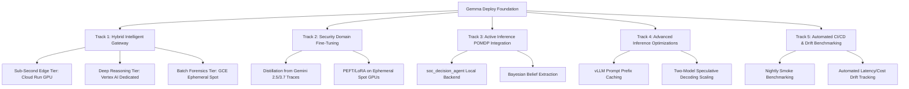

# Future Work & Strategic Roadmap

## Current priority: verified evaluation evidence

Updated September 6, 2026. The next milestone is one reproducible comparison supporting a deployment decision for a bounded SOC workflow.

1. Fail explicitly when evaluation cannot run; preserve evaluator status, artifacts, and cleanup outcomes independently.
2. Reconcile historical narrative/JSON discrepancies and label missing provenance. Generate future tables from preserved result artifacts.
3. Freeze separate train, validation, and untouched final-test datasets. Agree task completion, unsafe-action, latency, and cost acceptance criteria with an intended user before final testing.
4. Compare one open model and a managed baseline under fixed conditions. Measure wall-clock throughput, label token estimates, preserve failed requests, and verify cleanup.
5. Record the deployment recommendation, user review, contribution evidence, and adoption or iteration decision in [the decision record](evaluation_decision_record.md).

Run `bun scripts/validate_experiment.ts configs/experiments/evidence_comparison.template.json` to inspect missing experiment inputs. The template deliberately fails until real dataset hashes, reviewer approval, configuration, and exposure-history evidence are supplied. This is offline preflight, not proof of independent evaluation or a live result.

The tracks below are a historical backlog, not current delivery commitments. Their quoted measurements and platform assumptions require fresh evidence before reuse. Resume a track when the bounded comparison or an actual user need justifies it.

---

## Strategic Tracks Overview

---

## Track 1: Hybrid Intelligent Model Gateway & Traffic Router

### Objective
Implement an adaptive routing layer that dynamically dispatches incoming security triage alerts to the most cost-effective and latency-optimal runtime architecture based on prompt complexity and severity.

### Architecture & Routing Tiers
1. **Tier 1 (Sub-Second / Edge)**:
   - **Target**: Cloud Run GPU (`1x NVIDIA L4`, `--min-instances=0`).
   - **Models**: `gemma-3-1b-it` (0.87s cold start), `gemma-3-4b-it` (88.0 rubric score).
   - **Workloads**: IOC format normalization, RFC-5737 private IP containment checks, single-entity reputation lookups, initial triage deduplication.
2. **Tier 2 (Deep Investigation & Multi-Hop Pivoting)**:
   - **Target**: Vertex AI Dedicated Endpoints (`4x NVIDIA L4` or `2x NVIDIA A100`).
   - **Models**: `gemma-4-31b-it`, `llama-4-scout-17b-16e-instruct-maas`, `qwen3.8-27b`.
   - **Workloads**: Multi-stage attack chain correlation, UDM log search pivoting, complex malware family attribution, YARA-L rule drafting.
3. **Tier 3 (Batch Retrospective Sweeps & Forensics)**:
   - **Target**: Compute Engine Ephemeral Spot GPU VMs (`run_gce_spot_sweep.py`) and GKE Ray Kueue clusters.
   - **Models**: All 34 catalog configurations with automated self-termination and $0.00 idle cost.
   - **Workloads**: Bulk historical log re-evaluations, threat hunting campaigns, offline compliance audits.

### Planned Deliverables
- `gateway/router.py`: Lightweight FastAPI / Cloud Run proxy service evaluating prompt heuristics, regex signals, and confidence thresholds.
- `configs/routing_policy.json`: Declarative latency, token budget, and fallback configuration per alert category.
- `tests/test_model_gateway.py`: Unit and mocked routing integration tests.

---

## Track 2: Security Domain Fine-Tuning & Knowledge Distillation (LoRA / SFT)

### Objective
Elevate compact open-weight models (`gemma-3-4b-it`, `gemma-4-e4b-it`) to achieve frontier-grade rubric compliance (95%+ on the SOC Tier 1 Benchmark Suite) by distilling reasoning traces from Gemini 2.5 Pro and Gemini 3.7 Flash.

### Methodology
1. **Synthetic Distillation Dataset Generation**:
   - Extract multi-step tool trajectory logs, chain-of-thought rationale, and final triage decisions generated by Gemini 2.5 Pro and Gemini 3.7 Flash from `soc_tier1_evalset.json` evaluation runs.
   - Filter and sanitize into high-quality instruction-following pairs covering Chronicle UDM search syntax, VirusTotal / RFC-5737 IOC checks, and SOAR case comment schemas.
2. **Parameter-Efficient Fine-Tuning on Ephemeral Spot GPUs**:
   - Package a LoRA / QLoRA fine-tuning pipeline in `scripts/train_gemma_security_lora.py` utilizing Unsloth / TRL.
   - Execute training jobs on ephemeral Spot `g2-standard-48` instances with direct checkpoint export to Cloud Storage (`gs://secops-demo-env-evals/lora_checkpoints/`).
3. **Automated Post-Training Regression Evaluation**:
   - Automatically evaluate fine-tuned adapters against the benchmark harness (`scripts/eval_soc_agent.py`) to verify rubric score improvements without tool-calling degradation.

### Planned Deliverables
- `scripts/train_gemma_security_lora.py`: Distributed training script with Spot preemption handling.
- `datasets/soc_distillation_train.jsonl`: Curated function-calling and SOC triage distillation dataset.
- `docs/soc_lora_distillation_report.md`: Comparative post-training evaluation report.

---

## Track 3: Cross-Project Integration with `soc_decision_agent` (Active Inference POMDP)

### Objective
Integrate self-hosted Gemma inference endpoints as local, air-gapped, or cost-capped observation backends for the Active Inference SOC Decision Agent (`soc_decision_agent`).

### Integration Points
1. **Local Observation Matrix Extractor**:
   - Wire the POMDP Bayesian observation model in `soc_decision_agent` directly to local Gemma vLLM endpoints on Cloud Run GPU or Vertex AI.
   - Provide local entity feature extraction, reducing dependence on external public APIs during high-volume alert bursts.
2. **Socratic Epistemic Disambiguation Support**:
   - Leverage `gemma-3-4b-it` and `gemma-4-e4b-it` to generate candidate hypothesis questions and expected value of information (EVOI) disambiguation prompts.

### Planned Deliverables
- `agent/backend_connector.py`: Standardized OpenAI/vLLM client adapter compatible with `soc_decision_agent`'s inference abstraction layer.
- `docs/soc_decision_agent_integration_guide.md`: End-to-end configuration guide for local POMDP state estimation.

---

## Track 4: Advanced vLLM Inference & Speculative Decoding Optimizations

### Objective
Maximize serving throughput (tokens per second) and minimize Time-To-First-Token (TTFT) for enterprise SOC production workloads.

### Optimization Areas
1. **Prompt Prefix Caching (`--enable-prefix-caching`)**:
   - Enable and benchmark automatic prefix caching in vLLM container instances across Gemma 3 and Gemma 4 models.
   - Quantify latency reduction on repetitive system instructions and standardized SOC runbook templates (targeting 60-80% TTFT reduction).
2. **Two-Model Draft Speculative Decoding Scaling**:
   - Benchmark multi-GPU draft configurations:
     - `gemma-3-1b-it` (Draft) -> `gemma-3-27b-it` (Target) on `g2-standard-48` (4x L4, TP=4).
     - `gemma-4-e2b-it` (Draft) -> `gemma-4-31b-it` (Target) on `a2-highgpu-2g` (2x A100, TP=2).
   - Measure empirical speedup vs. standalone FP8 execution under concurrent request loads.

### Planned Deliverables
- `docs/speculative_decoding_benchmarks.md`: Comprehensive empirical latency, throughput, and memory comparison across speculative decoding and prefix caching setups.
- Updated `configs/models.json`: Calibrated `--speculative-model` parameter defaults.

---

## Track 5: Automated Cloud Build & Continuous Evaluation Pipeline

### Objective
Establish continuous verification and drift detection across model flavors, container versions, and Terraform modules.

### Pipeline Components
1. **PR Automated Presubmit Verification**:
   - Cloud Build triggers running `pytest -v` across all unit test suites on every pull request.
   - Syntax validation for Justfile recipes, Kubernetes YAML manifests, and Terraform plans.
2. **Scheduled Smoke Benchmarking**:
   - Scheduled Cloud Build runner triggering an ephemeral GCE Spot instance (`just gce-spot-run gemma-3-4b-it`) against the 5-case SOC evaluation set.
   - Automated upload of scorecard metrics to BigQuery / GCS for historical trend visualization and drift alerts.

### Planned Deliverables
- `cloudbuild.yaml`: Multi-stage Cloud Build configuration for linting, test suites, and Docker image builds.
- `docs/ci_cd_architecture.md`: Architecture guide and alert notification setup.
