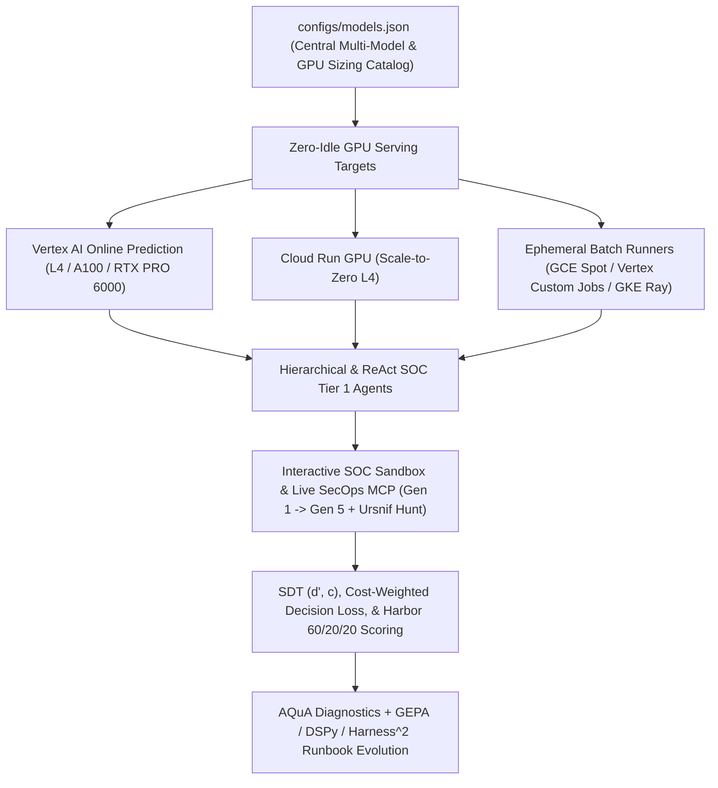

# Open Model & Gemma Deployment on Google Cloud (`open-model-deploy-gcp`)

Automated deployment orchestration, Terraform modules, `Justfile` recipes, and rigorous Security Operations Center (SOC) agent evaluation harnesses for deploying the **Google Gemma family** (Gemma 2 2B/9B/27B, Gemma 3 1B/4B/12B/27B, Gemma 4 E2B/E4B/31B, FP8, and Speculative Decoding variants), **Meta Llama models** (Llama 4 Scout/Maverick, Llama 3.x, Llama Guard), and **frontier open-weight partner models** (NVIDIA Nemotron 3.5 Super VL & Lightning, Thinking Machines Inkling, Qwen 3.8, DeepSeek V4, Zhipu GLM, Moonshot Kimi) across **Vertex AI Online Prediction**, **Cloud Run with GPU**, **Compute Engine Ephemeral Spot VMs**, **Vertex AI Custom Jobs**, and **GKE Ray Serve + Kueue**, alongside managed Gemini baselines.



---

## Core Project Pillars

1. **Zero-Idle Multi-Model GPU Serving Infrastructure**:
   - Single declarative catalog (`configs/models.json`) mapping 30+ open-weight and managed model variants to exact GPU shapes (`1x L4`, `4x L4`, `2x A100`, `1x/4x RTX PRO 6000`), vLLM quantization (`FP8`, `NVFP4`), and speculative decoding (`N-gram Prompt Lookup`, two-model draft speculative decoding, and `MTP`).
   - Automated lifecycle teardown (`just vertex-undeploy`, ephemeral Spot self-deletion, and Cloud Run `--min-instances=0`) preventing idle GPU billing leaks ([Part 1: Zero-Idle GPU Infrastructure](blog/part1_zero_idle_gpu_infrastructure.md)).
2. **Multi-Generational Agentic SOC Evaluation Suite (Gen 1 -> Gen 5 & Track 2 Threat Hunting)**:
   - Evaluates models on interactive SIEM/SOAR/GTI investigation and containment trajectories rather than static multiple-choice prompts ([Gen 5 Suite Guide](evals_gen5.md), [Gemma SOC Evaluation Plan](gemma_soc_agent_evaluation_plan.md)).
   - Measures **Signal Detection Theory** sensitivity ($d'$) and criterion bias ($c$), **asymmetric blast-radius financial loss** ($L(\text{FP, Critical}) = \$50\text{k}$, $L(\text{FN, Critical}) = \$250\text{k}$), **counterfactual twin consistency**, and **containerized Harbor v1.3 60/20/20 rewards**.
3. **Disciplined Hillclimbing, DSPy Context Hygiene, & $\text{Harness}^2$ Recursive Runbook Evolution**:
   - Enforces the 10 empirical Agentic Runbook Hygiene rules ([Runbook Authoring Best Practices](RUNBOOK_AUTHORING_BEST_PRACTICES.md)) and anti-memorization guards ([Evolving SecOps Runbooks Without Cheating](blog/gepa_runbook_evolution_and_disciplined_hillclimbing.md)).
   - Uses $\text{Harness}^2$ (`arXiv:2610.14224`, [google-research/harness2](https://github.com/google-research/harness2)) contrastive `INV`/`DOM` Propose-Probe-Compose, `ComponentStratifiedBatchSampler`, categorical inner-probe gating, and `ExperienceLibrary` to compress verbose human SOPs by `52.2% - 65.5%` while lifting 3-model Gen 5 validation Harbor reward to `0.9804` (`\$1,834.24` mean loss, `-89.1%` vs. seed and `-94.5%` vs. single-proposer GEPA) and Track 2 Ursnif threat hunting to `0.9813` mean Hunt Composite ([`Harness^2` 8-Hour Campaign Report](soc_eval_results/harness2_8h_campaign/HARNESS2_CAMPAIGN_REPORT.md), [Gen 5 Transfer Scorecard](soc_eval_results/harness2_8h_campaign/gen5_transfer/GEN5_TRANSFER_SCORECARD.md), [Track 2 Threat-Hunt Scorecard](soc_eval_results/harness2_8h_campaign/threat_hunt_multi_model/THREAT_HUNT_MULTI_MODEL_SCORECARD.md), [DSPy Overnight Report](soc_eval_results/dspy_overnight/MORNING_REPORT.md)).
4. **MCP Tool Description Optimization**:
   - Evolves MCP tool schemas across `secops-mcp`, `gti-mcp`, and `secops-soar-mcp` to eliminate routing collisions and boost multi-server tool selection accuracy ([Evolving SecOps MCP Tool Descriptions](blog/gepa_mcp_tool_description_optimization.md)).

### $\text{Harness}^2$ Cross-Model Transfer Highlights (`228` Total Trajectories)

| Benchmark Suite | Runbook Arm | Words | Mean Harbor 60/20/20 | Primary Composite / Fitness | Mean Operational Loss ($L$, USD) | Safety Violations |
| :--- | :--- | ---: | ---: | ---: | ---: | ---: |
| **Gen 5 Tier 1 (`180` trajectories, 3 models)** | `seed_runbooks` (`.clinerules`) | `3,648` | `0.9744` | `0.9584` (GEPA Fitness) | `\$16,834.40` | `0` |
| **Gen 5 Tier 1 (`180` trajectories, 3 models)** | `gepa_single_proposer` | `1,988` | `0.9787` | `0.9627` (GEPA Fitness) | `\$33,417.74` | `0` |
| **Gen 5 Tier 1 (`180` trajectories, 3 models)** | **`harness2_k2_evolved`** | **`1,743`** (`-52.2%`) | **`0.9804`** | **`0.9804`** (GEPA Fitness) | **`\$1,834.24`** (**`-89.1%`** vs seed, **`-94.5%`** vs single-proposer) | **`0`** |
| **Track 2 Threat Hunt (`48` trajectories, 3 models)** | `raw_clinerules_hunt` | `892` | `0.8575` | `0.8295` (Hunt Composite) | n/a (`56%` `168h` widening) | `0` |
| **Track 2 Threat Hunt (`48` trajectories, 3 models)** | `compressed_track_b_hunt` | `350` | `0.9337` | `0.9510` (Hunt Composite) | n/a (`100%` `168h` widening) | `0` |
| **Track 2 Threat Hunt (`48` trajectories, 3 models)** | **`harness2_evolved_hunt`** | **`347`** | **`0.9587`** | **`0.9813`** (Hunt Composite) | n/a (**`100%` `168h` widening & LOLBin safe**) | **`0`** |

---

## 1. Multi-Model Architecture & Central Catalog

The repository uses a single declarative source of truth at `configs/models.json` that defines the exact compute hardware, VRAM, context length, and target environments for each model flavor:

### Google Gemma Family

| Flavor | Architecture / Scale | Recommended Compute | GPU Hardware | Hourly Cost | Target Environments |
| :--- | :--- | :--- | :--- | :--- | :--- |
| **`gemma-2-2b-it`** | 2.6B Dense | `g2-standard-4` | 1x NVIDIA L4 | **\$0.70 / hr** | Vertex AI, Cloud Run (\$0 idle) |
| **`gemma-2-9b-it`** | 9.2B Dense | `g2-standard-12` | 1x NVIDIA L4 | **\$0.83 / hr** | Vertex AI, Cloud Run (\$0 idle) |
| **`gemma-2-27b-it`** | 27.2B Dense | `g2-standard-48` | 4x NVIDIA L4 | **\$3.36 / hr** | Vertex AI |
| **`gemma-3-1b-it`** | 1.0B Dense | `g2-standard-4` | 1x NVIDIA L4 | **\$0.70 / hr** | Vertex AI, Cloud Run (\$0 idle) |
| **`gemma-3-4b-it`** | 4.0B Dense | `g2-standard-8` | 1x NVIDIA L4 | **\$0.76 / hr** | Vertex AI, Cloud Run (\$0 idle) |
| **`gemma-3-12b-it`** | 12.0B Multimodal | `g2-standard-48` | 4x NVIDIA L4 | **\$3.36 / hr** | Vertex AI |
| **`gemma-3-27b-it`** | 27.0B Multimodal | `g2-standard-48` | 4x NVIDIA L4 | **\$3.36 / hr** | Vertex AI |
| **`gemma-3-27b-it-fp8`** | 27.0B (FP8 Quantized) | `g2-standard-48` | 4x NVIDIA L4 | **\$3.36 / hr** | Vertex AI |
| **`gemma-3-27b-it-speculative`** | 27.0B (FP8 + Prompt Lookup) | `g2-standard-48` | 4x NVIDIA L4 | **\$3.36 / hr** | Vertex AI |
| **`gemma-4-e2b-it`** | 2.3B eff / 5.1B MoE | `g2-standard-4` | 1x NVIDIA L4 | **\$0.70 / hr** | Vertex AI, Cloud Run (\$0 idle) |
| **`gemma-4-e4b-it`** | 4.5B eff / 8.0B MoE | `g2-standard-8` | 1x NVIDIA L4 | **\$0.76 / hr** | Vertex AI, Cloud Run (\$0 idle) |
| **`gemma-4-31b-it`** | 31.0B Reasoner | `a2-highgpu-2g` | 2x NVIDIA A100 | **\$7.34 / hr** | Vertex AI |

### Meta Llama & Partner Model Garden / OpenModels

| Flavor | Provider | Model Type | Recommended Compute | Hardware / Tier |
| :--- | :--- | :--- | :--- | :--- |
| **`llama-4-scout-17b-16e-instruct-maas`** | Meta | 17B active MoE | Serverless MaaS | `us-east5` |
| **`llama-4-maverick-17b-128e-instruct-maas`** | Meta | 17B active MoE | Serverless MaaS | `us-east5` |
| **`llama-3.1-nemotron-70b-instruct`** | NVIDIA / Meta | 70B Aligned Dense | `g2-standard-48` | 4x NVIDIA L4 (\$3.32/hr) |
| **`llama-guard-3-8b`** | Meta | 8B Safety Classifier | `g2-standard-12` | 1x NVIDIA L4 (\$1.01/hr) |
| **`llama-3.2-3b-instruct`** | Meta | 3.2B Compact Dense | `g2-standard-8` | 1x NVIDIA L4 (\$0.83/hr) |
| **`inkling-small`** | Thinking Machines | OpenModel | `g2-standard-48` | 4x NVIDIA L4 (\$3.32/hr) |
| **`nemotron-3.5-lightning-bf16`** | NVIDIA | 30B MoE | `g2-standard-48` | 4x NVIDIA L4 (\$3.32/hr) |
| **`nemotron-3.5-super-vl-nvfp4`** | NVIDIA | 120B-A12B Multimodal MoE (NVFP4) | `g4-standard-48` | 1x RTX PRO 6000 (\$3.85/hr) |
| **`nemotron-3.5-super-vl-bf16`** | NVIDIA | 120B-A12B Multimodal MoE (BF16) | `g4-standard-192` | 4x RTX PRO 6000 (\$15.40/hr) |
| **`qwen3.8-27b`** | Qwen / HF | 27B OpenModel | `g4-standard-48` | 1x RTX PRO 6000 (\$3.85/hr) |
| **`qwen3.8-flash-next`** | Qwen / HF | OpenModel | `g2-standard-12` | 1x NVIDIA L4 (\$1.01/hr) |
| **`qwen3.8-flash-next-fp8`** | Qwen / HF | FP8 OpenModel | `g2-standard-8` | 1x NVIDIA L4 (\$0.83/hr) |
| **`qwen3.8-2.4t-a95b-fp8`** | Qwen / HF | 2.4T / A95B MoE FP8 | `g4-standard-48` | 1x RTX PRO 6000 (\$3.85/hr) |
| **`glm-5.3-flash`** | Zhipu AI / THUDM | OpenModel | `g2-standard-12` | 1x NVIDIA L4 (\$1.01/hr) |
| **`deepseek-v4-pro`** | DeepSeek | OpenModel | `g4-standard-48` | 1x RTX PRO 6000 (\$3.85/hr) |
| **`kimi-k3`** | Moonshot AI | OpenModel | `g4-standard-48` | 1x RTX PRO 6000 (\$3.85/hr) |

---

## 2. Master Comparative Evaluation Leaderboard

Models evaluated on the un-spoiled SOC Tier 1 Benchmark Suite (covering C2 malware beaconing, RFC-5737 documentation subnet grounding, phishing credential harvesting, SOAR ticket deduplication, critical ransomware escalation, borderline DNS tunneling, lateral movement, supply chain revoked certificates, threat intelligence HTTP 503 outage resilience, and authorized vulnerability scanner noise):

| Rank | Model Flavor | Provider / Serving | Pass Rate | Avg Rubric | Latency | Gen TPS | Total TPS | Tool Calls |
| :---: | :--- | :--- | :---: | :---: | :---: | :---: | :---: | :---: |
| 1 | **`gemini-3.5-flash-lite`** | Google MaaS | **100.0% (5/5)** | **97.0 / 100** | 11.36 s | 70.22 tok/s | 241.65 tok/s | 5 |
| 2 | **`gemma-3-12b-it`** | Vertex AI Dedicated (4x L4) | **60.0% (3/5)** | **91.0 / 100** | 25.19 s | 19.30 tok/s | 71.63 tok/s | 4 |
| 3 | **`gemma-4-e4b-it`** | Vertex AI Dedicated (1x L4) | **80.0% (4/5)** | **91.0 / 100** | 40.24 s | 15.27 tok/s | 44.56 tok/s | 3 |
| 4 | **`qwen3.8-27b`** | Dedicated OpenModel (1x RTX 6000) | **60.0% (3/5)** | **88.4 / 100** | 29.12 s | 26.50 tok/s | 101.02 tok/s | 5 |
| 5 | **`llama-3.1-nemotron-70b-instruct`** | Dedicated Model Garden (4x L4) | **60.0% (3/5)** | **86.0 / 100** | 18.83 s | 43.93 tok/s | 190.58 tok/s | 6 |
| 6 | **`inkling-small`** | Dedicated Model Garden (4x L4) | **60.0% (3/5)** | **85.0 / 100** | 15.60 s | 51.22 tok/s | 214.50 tok/s | 6 |
| 7 | **`llama-4-scout-17b-16e-instruct-maas`** | Meta Serverless MaaS (`us-east5`) | **60.0% (3/5)** | **85.0 / 100** | 12.21 s | 66.70 tok/s | 332.76 tok/s | 10 |
| 8 | **`gemma-4-31b-it`** | Vertex AI Dedicated (2x A100) | **60.0% (3/5)** | **85.0 / 100** | 17.45 s | 51.23 tok/s | 233.48 tok/s | 8 |
| 9 | **`llama-guard-3-8b`** | Dedicated Model Garden (1x L4) | **80.0% (4/5)** | **84.0 / 100** | 16.32 s | 49.06 tok/s | 235.33 tok/s | 8 |
| 10 | **`nemotron-3.5-super-vl-nvfp4`** | Dedicated Model Garden (1x RTX PRO 6000) | **50.0% (5/10)** | **83.0 / 100** | 45.84 s | 186.87 tok/s | 439.65 tok/s | 20 |
| 11 | **`llama-3.2-3b-instruct`** | Dedicated Model Garden (1x L4) | **40.0% (2/5)** | **84.0 / 100** | 22.63 s | 44.96 tok/s | 250.51 tok/s | 11 |
| 12 | **`gemma-4-31b-it-speculative`** | Vertex AI Dedicated (2x A100) | **60.0% (3/5)** | **82.4 / 100** | 14.81 s | 54.45 tok/s | 223.31 tok/s | 6 |
| 13 | **`nemotron-3.5-lightning-bf16`** | Dedicated Model Garden (4x L4) | **40.0% (2/5)** | **79.0 / 100** | 17.98 s | 37.02 tok/s | 186.45 tok/s | 6 |
| 14 | **`gemma-3-12b-it-fp8`** | Vertex AI Dedicated (4x L4) | **60.0% (3/5)** | **79.0 / 100** | 14.21 s | 61.76 tok/s | 216.37 tok/s | 4 |
| 15 | **`gemini-2.5-flash`** | Google MaaS | **60.0% (3/5)** | **75.2 / 100** | 11.74 s | 59.64 tok/s | 271.41 tok/s | 6 |
| 16 | **`llama-4-maverick-17b-128e-instruct-maas`** | Meta Serverless MaaS (`us-east5`) | 0.0% (0/5) | 53.0 / 100 | 12.94 s | 58.73 tok/s | 124.25 tok/s | 0 |

---

## 3. Quick Start (`Justfile`)

```bash
# Display categorized help menu
just

# View models in catalog and Model Registry
just model-list

# View infrastructure pricing matrix across all models
just cost-list

# Validate SOC runbooks against the 10 context hygiene & word-budget rules
just lint-runbooks

# Verify Gen 5 family-instanced SOC bundles and harness lock
just gen5-check
just harness-verify

# Run Harness^2 Propose-Probe-Compose recursive evolution on Gen 5 (train -> validation)
just gepa-evolve-harness2 gemini-2.5-flash-lite 15 gemini-2.5-pro

# Run Gen 5 SOC evaluation on validation split through the exposure ledger
just eval-gen5 gemini-2.5-flash-lite validation
```

### Model Deployment Recipes

```bash
FLAVOR_GEMMA2="gemma-2-9b-it"
FLAVOR_GEMMA3="gemma-3-12b-it"
FLAVOR_GEMMA4="gemma-4-e4b-it"
FLAVOR_CLOUDRUN="gemma-2-2b-it"
FLAVOR_OPENMODEL="qwen3.8-27b"

# Deploy Gemma 2 9B to Vertex AI (auto-selects g2-standard-12, 1x L4)
just vertex-deploy "$FLAVOR_GEMMA2"

# Deploy Gemma 3 12B Multimodal to Vertex AI (auto-selects g2-standard-48, 4x L4)
just vertex-deploy "$FLAVOR_GEMMA3"

# Deploy Gemma 4 E4B to Vertex AI (auto-selects g2-standard-8, 1x L4)
just vertex-deploy "$FLAVOR_GEMMA4"

# Deploy Gemma 2 2B to Cloud Run with Scale-to-Zero ($0 idle)
just cloudrun-deploy "$FLAVOR_CLOUDRUN"

# Deploy Hugging Face / Model Garden OpenModel via Vertex AI SDK
just openmodel-deploy "$FLAVOR_OPENMODEL"

# Deploy NVIDIA Nemotron 3.5 Super VL (120B-A12B NVFP4 on 1x RTX PRO 6000, $3.85/hr)
NEMOTRON_FLAVOR="nemotron-3.5-super-vl-nvfp4"
NEMOTRON_ID="publishers/nvidia/models/nemotron-3.5@nemotron-3.5-super-vl-nvfp4"
MACHINE_TYPE="g4-standard-48"
ACCEL_TYPE="NVIDIA_RTX_PRO_6000"

python3 scripts/deploy_open_model.py \
  --flavor "$NEMOTRON_FLAVOR" \
  --open-model-id "$NEMOTRON_ID" \
  --machine-type "$MACHINE_TYPE" \
  --accelerator-type "$ACCEL_TYPE" \
  --accelerator-count 1

# Query the active model endpoint and tear down to guarantee $0 idle cost
just predict "Explain phishing triage in two paragraphs."
just vertex-undeploy
```

---

## 4. Explore the Documentation

- **Catalog & Summaries**:
  - [Executive Project Summary](PROJECT_SUMMARY.md)
  - [Full Documentation Catalog (45+ Guides & Reports)](catalog.md)
  - [Vertex AI Model Registry Master Catalog](model_registry_catalog.md)
  - [Cost Analysis & Hardware Sizing Breakdown](cost_analysis.md)
- **SOC Agent Evals & Benchmarks**:
  - [Master Dynamic Benchmark Leaderboard](soc_eval_results/OVERNIGHT_SWEEP_SUMMARY.md)
  - [Gemma vs. Gemini Comparative Evaluations](soc_model_comparative_evals.md)
  - [Llama & Partner Model Comparative Evaluations](llama_model_comparative_evals.md)
  - [Gen 5 Family-Instanced SOC Evaluation Suite](evals_gen5.md)
- **GEPA, DSPy Context Hygiene, & $\text{Harness}^2$ Evolution**:
  - [Empirical Runbook Authoring Best Practices (`RB-01`..`RB-05`)](RUNBOOK_AUTHORING_BEST_PRACTICES.md)
  - [DSPy Context Engineering & 9-Hour Overnight Report](soc_eval_results/dspy_overnight/MORNING_REPORT.md)
  - [$\text{Harness}^2$ 8-Hour Recursive Runbook Evolution Report (`arXiv:2610.14224`)](soc_eval_results/harness2_8h_campaign/HARNESS2_CAMPAIGN_REPORT.md)
  - [Gen 5 Cross-Model Transfer & Cost Staircase Scorecard (`180` Trajectories)](soc_eval_results/harness2_8h_campaign/gen5_transfer/GEN5_TRANSFER_SCORECARD.md)
  - [Track 2 Proactive Threat Hunting Multi-Model Scorecard (`48` Trajectories)](soc_eval_results/harness2_8h_campaign/threat_hunt_multi_model/THREAT_HUNT_MULTI_MODEL_SCORECARD.md)
  - [Disciplined Hillclimber vs. RRSI & $\text{Harness}^2$ Crosswalk](hillclimber_rrsi_crosswalk.md)
  - [Annotated Agent Harness Literature Bibliography](references_agent_harness_literature.md)
- **Blog Series**:
  - [Part 1: Zero-Idle GPU Infrastructure for Security Agents](blog/part1_zero_idle_gpu_infrastructure.md)
  - [Evolving SecOps Runbooks Without Cheating: GEPA, Verbosity Bias, & Disciplined Hillclimbing](blog/gepa_runbook_evolution_and_disciplined_hillclimbing.md)
  - [Evolving SecOps MCP Tool Descriptions with GEPA](blog/gepa_mcp_tool_description_optimization.md)
- **Deployment & Ephemeral Sweep Guides**:
  - [Vertex AI Online Prediction Deployment Notes](vertex_deployment_notes.md)
  - [Cloud Run GPU Scale-to-Zero Deployment Guide](cloudrun_deploy.md)
  - [Speculative Decoding & Prompt Lookup Guide](speculative_decoding.md)
  - [Compute Engine Ephemeral Spot GPU VMs Guide](benchmarking_gce_ephemeral_spot_vms.md)
  - [Vertex AI Custom Jobs Ephemeral Runner Guide](benchmarking_vertex_custom_jobs.md)
  - [GKE Ray Serve & Kueue Distributed Batch Sweep Guide](benchmarking_gke_ray_serve.md)
