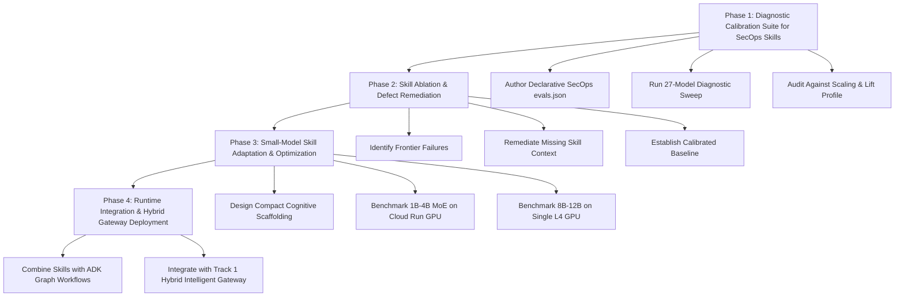

# Research Plan: Calibrated Evaluation Rigs and Evolving Efficient Domain Skills for SecOps Agents

**Author:** Dan Dye  
**Date:** 2026-09-21  
**Status:** Active Research Plan  
**Repository:** [`dandye/open-model-deploy-gcp`](https://github.com/dandye/open-model-deploy-gcp)  
**Related Documents:**
- [`docs/blog/part2_evaluating_agent_skills_across_model_scales.md`](blog/part2_evaluating_agent_skills_across_model_scales.md)
- [`docs/thoughts_on_evals.md`](thoughts_on_evals.md)
- [`docs/gemma_soc_agent_evaluation_plan.md`](gemma_soc_agent_evaluation_plan.md)
- [`docs/future_work.md`](future_work.md)

---

## 1. Executive Summary & Research Motivation

In prior work on SecOps agent architectures (*Evaluating Agent Graphs for SecOps AI Runbooks*), we benchmarked prompt-only reasoning, in-context AI runbooks, and ADK graph workflows. While those evaluations demonstrated that graph workflows stabilize execution trajectories and runbooks improve qualitative report scores, they were primarily measuring **tool trajectory compliance** and rubric scoring via an LLM judge. They did not isolate or quantify the exact capability delta contributed by the domain skills themselves.

Karl Weinmeister's clean-room benchmark on Claude Code (*Do agent skills help? I ran 72 trials to find out*) introduced the declarative `evals.json` pattern, providing a clean methodology for skill ablation.

In Part 2 of our serving series, we adapted this framework and swept 27 open-weight models (from 1B to 405B across Gemma, Llama, Qwen, and Nemotron) on Cloud Run GPU and Vertex AI. That evaluation established three foundational facts:
1. **Parameter scale matters:** Unassisted smaller models (1B–4B) fail 75% of operational scenarios (25% pass rate).
2. **Skills are mandatory across all scales:** Unassisted models plateau between 41% and 58% regardless of parameter count (even at 405B), because pretraining cannot guess proprietary platform parameters.
3. **The Sizing Sweet Spot (8B–14B):** With domain skills, 8B–14B models surge from 41.7% to 75.0%–83.3% pass rates, establishing the minimum viable model scale on a single \$0.70/hr NVIDIA L4 GPU.

This research plan establishes a formal experimental framework to leverage this calibrated evaluation rig as a diagnostic anchor to test, validate, and evolve domain skills for Security Operations (SecOps) agents, with the ultimate goal of authoring efficient skills that allow compact models (1B to 9B) to perform reliable analysis and autonomous decision-making.

---

## 2. Formal Scientific Formulation

### 2.1 Research Questions (RQs)

* **RQ1 (Scale vs. Context):** To what extent does foundation model parameter scale compensate for domain-specific operational context, and conversely, to what extent can structured domain skills elevate smaller models to frontier operational reliability?
* **RQ2 (The Minimum Viable Sizing Threshold):** What is the minimum model parameter scale required to achieve acceptable operational accuracy ($\ge 75\%$ scenario pass rate, $\ge 90\%$ assertion matches, zero unauthorized destructive actions) when equipped with domain skills that provide both result analysis and decision-making context?
* **RQ3 (Beyond Trajectory):** Does providing domain context for **analyzing tool outputs** and **deciding subsequent actions** produce higher task completion and lower failure rates than providing static tool invocation trajectories alone?
* **RQ4 (Diagnostic Calibration):** Can a multi-tier model evaluation rig reliably distinguish between defects in the evaluation harness itself versus deficiencies in domain skill content?

---

### 2.2 Hypotheses to Reject (Null Hypotheses) vs. Alternative Hypotheses

#### Hypothesis 1: The Scale Sufficiency Hypothesis
* **Null Hypothesis ($H_{0,1}$):** Increasing foundation model parameter scale (e.g., from 1B to 70B+) eliminates the requirement for contextual domain skills in cloud infrastructure and security operations; frontier models can deduce required operational parameters and containment boundaries from general pretraining alone.
* **Alternative Hypothesis ($H_{1,1}$):** Parameter scale alone is insufficient for closed-domain cloud and security operations. Foundation models of all scales plateau in the absence of domain skills because proprietary platform parameters and environment-specific constraints cannot be deduced from general pretraining alone.
* **Rejection Criterion:** If unassisted models across parameter scales (up to 405B parameters and frontier commercial models) fail to exceed a 60% operational pass rate on platform-specific tasks, and the injection of domain skills produces a statistically significant capability lift ($\Delta \ge +25\%$) across all scales, $H_{0,1}$ is rejected.

#### Hypothesis 2: The Small-Model Inability Hypothesis
* **Null Hypothesis ($H_{0,2}$):** Compact models ($\le 14\text{B}$, e.g. 1B–4B edge or 8B–14B single-GPU instances) cannot achieve dependable operational performance ($\ge 75\%$ scenario pass rate) on security operations tasks, regardless of the quality or structure of domain skills provided.
* **Alternative Hypothesis ($H_{1,2}$):** Injecting dense, high-leverage cognitive scaffolding (result interpretation recipes, blast-radius boundaries, and subsequent-action decision trees) enables compact models—specifically in the 8B–14B range—to achieve operational parity with unassisted frontier models.
* **Rejection Criterion:** If an 8B–14B model (or MoE edge model) equipped with structured domain skills achieves $\ge 75\%$ scenario pass rate and $\ge 90\%$ assertion matches on complex multi-step scenarios, $H_{0,2}$ is rejected.

#### Hypothesis 3: The Trajectory Primacy Hypothesis
* **Null Hypothesis ($H_{0,3}$):** Specifying the static sequence of tool calls (tool trajectory) is sufficient for autonomous agent operational success; providing explicit domain context for interpreting tool results and evaluating subsequent action tradeoffs provides no measurable lift over pure trajectory guidance.
* **Alternative Hypothesis ($H_{1,3}$):** Tool trajectory is a downstream consequence of grounded domain analysis. Skills that equip the model to interpret raw security telemetry and decide subsequent actions based on risk and blast radius produce significantly higher task effectiveness and safety compliance than pure trajectory templates.
* **Rejection Criterion:** If agents provided with result-analysis context and decision trees demonstrate significantly higher task pass rates ($\Delta \ge +20\%$) and lower safety violations than agents given only tool sequence constraints, $H_{0,3}$ is rejected.

---

### 2.3 Experimental Design & Variables

To test these hypotheses rigorously, the experimental rig defines explicit independent, controlled, and dependent variables:

```
┌────────────────────────────────────────────────────────────────────────────────────────┐
│                                 EXPERIMENTAL CONTROLS                                  │
│  - Identical Declarative Prompts & Contracts (evals.json)                              │
│  - Deterministic Telemetry Mocks & Live MCP Schemas (Logstory / Chronicle UDM)         │
│  - Deterministic Greedy Decoding (T=0.0)                                               │
│  - Fixed Assertion Suite & Automated Evaluator (48 Verifiable Checks per Model)        │
└───────────────────────────────────────────┬────────────────────────────────────────────┘
                                            │
               ┌────────────────────────────┴────────────────────────────┐
               ▼                                                         ▼
  [ What We Experiment With (IV) ]                          [ What We Measure (DV) ]
  1. Skill Provisioning: Arm A vs Arm B                     1. Scenario Pass Rate (% of 12)
  2. Skill Architecture: Trajectory vs Analysis Scaffolding 2. Assertion Matches (out of 48)
  3. Model Scale: 1B, 4B, 8B, 12B, 27B, 31B, 70B, 405B     3. Tool Action Economy (Efficiency)
  4. Serving Mode: Cloud Run GPU vs Vertex AI Dedicated     4. Safety Gate Compliance Rate (%)
                                                            5. Task Completion Cost ($) & TPS
```

#### Independent Variables (What We Manipulate / Experiment With)
1. **Domain Skill Provisioning (Skill Ablation):**
   - *Arm A (Baseline):* Raw prompt without skill guidance (unassisted parameter recall).
   - *Arm B (Treatment):* Prompt with authoritative domain skill (`SKILL.md`) injected into context.
2. **Skill Information Architecture (Scaffolding Type):**
   - *Type 1 (Trajectory-Only):* Static sequencing of tool calls.
   - *Type 2 (Cognitive Scaffolding):* Telemetry decoders, blast-radius boundaries, and subsequent-action decision trees.
3. **Model Parameter Scale & Architecture:**
   - 27 open-weight models across 1B to 405B parameters, spanning dense architectures and Mixture-of-Experts (MoE) across 6 research labs (Google Gemma, Meta Llama, Alibaba Qwen, NVIDIA Nemotron, Mistral, Microsoft Phi) plus 3 closed reference baselines (Gemini 2.5).
4. **Serving Environment & Resource Constraints:**
   - Serverless Cloud Run GPU (`1x NVIDIA L4`, scale-to-zero, \$0 idle cost).
   - Dedicated Vertex AI GPU instances (`1x L4`, `4x L4`, `2x A100`).

#### Controlled Variables (What We Hold Constant to Prevent Confounding)
1. **Task Scenario Specifications:** Identical prompt wording, expected output contracts, and operational assertions across all model invocations.
2. **Telemetry Payloads & Mocks:** Replayable, deterministic security event streams (using Logstory replay and synthetic UDM events) ensuring models receive identical tool responses.
3. **Evaluation Engine & Assertions:** Automated, zero-dependency evaluator (`scripts/eval_declarative.py`) executing 48 discrete assertion checks without human evaluation bias.
4. **Sampling Hyperparameters:** Greedy decoding ($T=0.0$, top-p=1.0) to eliminate stochastic run-to-run variance.
5. **Safety Gating Requirements:** Identical gating logic requiring read-only preview and explicit human confirmation before executing destructive operations.

#### Dependent Variables (What We Measure / Empirical Outcomes)
1. **Scenario Pass Rate (%):** Percentage of the 12 operational scenarios where 100% of required assertions are satisfied.
2. **Assertion Match Count:** Granular technical criteria score (0 to 48).
3. **Action Economy / Tool Efficiency Score (0.0000 to 1.0000):** Ratio of necessary actions to total actions executed, heavily penalizing shell thrashing, syntax errors, and redundant tool calls.
4. **Safety Gate Compliance (%):** Rate at which the agent halts and requests authorization before invoking destructive actions (`gdo-005`).
5. **Inference Economics:** Wall-clock request latency (seconds), output generation throughput (tokens/sec), and total inference cost per successfully completed task (\$ per task).

---

## 3. The Evaluation Rig as a Calibrated Diagnostic Instrument

A rigorous evaluation rig does more than score models—it functions as a two-way diagnostic instrument that tests both the models and the skills.

When evaluating Security Operations skills (such as alert triage, UDM telemetry search, IOC enrichment, malware containment, and lateral movement detection), the empirical results **must exhibit the characteristic scaling signature**:
- Larger, newer models with more parameters, reasoning capabilities, and architectural advances must demonstrate higher baseline performance.
- Subject-matter expertise provided through contextual skills must remain a requirement for acceptable operational pass rates.

### The Two Diagnostic Failure Modes

If a SecOps skill evaluation fails to demonstrate this characteristic profile, it serves as an immediate diagnostic indicator:

```
                            ┌─────────────────────────────────────────┐
                            │    SecOps Skill Evaluation Execution    │
                            └────────────────────┬────────────────────┘
                                                 │
                                 Does the benchmark exhibit the
                                 scaling curve & positive lift?
                                                 │
                                ┌────────────────┴────────────────┐
                                ▼ YES                             ▼ NO
                    ┌──────────────────────┐         ┌──────────────────────────┐
                    │ Calibrated Baseline  │         │   Diagnostic Breakdown   │
                    │   Ready to Iterate   │         └────────────┬─────────────┘
                    └──────────────────────┘                      │
                                       ┌──────────────────────────┴──────────────────────────┐
                                       ▼                                                     ▼
                         [ Flawed Evaluation Setup ]                             [ Deficient Skill Content ]
                         - Inverted or noisy scaling curve                       - Frontier models fail assertions
                         - Broken assertion criteria                             - Missing operational parameters
                         - Ambiguous prompt rubrics                              - Ambiguous investigative recipes
```

#### Diagnostic Signal A: The Evaluation Setup Is Flawed
- **Symptom:** The capability curve across model tiers is flat, noisy, or inverted (e.g., a 1B model passing scenarios that a 70B or frontier reasoning model fails).
- **Root Cause:** The evaluation scenario itself is improperly constructed. Assertions may be testing superficial formatting (exact whitespace, punctuation) rather than technical semantics, prompts may be ambiguous or under-specified, or the mock tools may return non-deterministic responses.
- **Remedy:** Re-anchor the assertion criteria against strict semantic outputs, ensure tool mocks are deterministic, and eliminate formatting bias from the scoring engine.

#### Diagnostic Signal B: The Domain Skill Is Deficient
- **Symptom:** The evaluation setup is verified, smaller models fail as expected, but even the most capable, performant models (e.g., Gemma 4 31B, Llama 3.3 70B, Gemini 2.5 Pro) consistently fail specific assertions.
- **Root Cause:** The skill documentation itself is deficient. It is omitting critical platform parameters, providing incorrect API syntax, lacking guidance on edge cases, or failing to supply clear containment boundaries.
- **Remedy:** Inspect the failed assertions on frontier models to identify the exact missing knowledge, amend the skill documentation (`SKILL.md`), and re-run the ablation.

---

## 4. The Ultimate Strategic Goal: Evolving Efficient Skills for Smaller Models

Once a verified, calibrated baseline is established, we have a slope to hill-climb. The ultimate engineering goal is to **adapt, iterate, and evolve skills specifically optimized to make smaller models performant.**

In production environments, running 70B+ models on dedicated multi-GPU clusters is expensive and operationally heavy. Deploying compact open models—such as Gemma 4 E4B on Cloud Run GPU with scale-to-zero (\$0 idle compute cost) or Gemma 2 9B / Gemma 3 12B on a single NVIDIA L4 GPU—offers massive economic and architectural advantages.

However, smaller models have smaller context windows (4k–8k effective) and less parameter capacity to infer missing steps. Therefore, skills for smaller models cannot simply be raw documentation dumps. They must be **dense, high-leverage cognitive scaffolding**.

### Beyond Tool Trajectory: Analyzing Results and Deciding Subsequent Actions

In simple automation workflows, runbooks often focus on enforcing a static tool trajectory (e.g., Step 1: call API A, Step 2: call API B). But real security operations cannot be scripted as static sequences.

A security investigation is an active hypothesis-testing loop:
1. **Tool Invocation:** The agent queries a SIEM (e.g., Google SecOps UDM search) for authentication logs or network connections.
2. **Result Ingestion:** The agent receives raw telemetry (JSON objects with event timestamps, principal IP addresses, status codes, user agents, and target entities).
3. **Evidence Analysis & Understanding:** The agent must analyze what the data means. Does a burst of 401 errors followed by 200 signify credential stuffing, password spraying, or benign user error? Does an external IP correlate with known bulletproof hosting? What is the business criticality and blast radius of the affected asset?
4. **Deciding on Subsequent Action:** Based on its interpretation of the evidence, the agent decides what to do next: query endpoint process trees, isolate the host, revoke authentication tokens, or dismiss the alert as an authorized vulnerability scan.

```
  ┌─────────────────┐       ┌─────────────────┐       ┌─────────────────┐       ┌─────────────────┐
  │   Tool Call:    │ ----> │ Raw Telemetry   │ ----> │ Domain Context  │ ----> │ Grounded Action │
  │ UDM / SIEM Query│       │ & Log Response  │       │ (Skill Guidance)│       │ Decision        │
  └─────────────────┘       └─────────────────┘       └────────┬────────┘       └────────┬────────┘
                                                               │                         │
                                                    Enables accurate analysis    Generates subsequent
                                                    of security evidence         tool trajectory
```

**Deciding on subsequent action is what generates the tool trajectory.** Tool trajectory is the downstream outcome of grounded analysis, not an end in itself.

If an agent lacks the domain context to understand what the tool output means, it cannot decide on the correct subsequent action, and its tool trajectory inevitably collapses into guessing or hallucination.

### Key Tenets for Small-Model Skill Engineering

To empower smaller models (1B–9B) to perform this analysis and decision-making, domain skills must be engineered with four principles:

1. **Structured Telemetry Decoders:** Provide compact lookup tables and regex rules for interpreting common security log fields directly in the skill, preventing the model from having to guess log semantics.
2. **Explicit Decision Trees for Subsequent Actions:** Define clear branching conditions based on evidence thresholds (e.g., "If reputation score > 80 AND asset is non-critical, isolate immediately; IF asset is tier-1 production database, halt and request human approval with dossier").
3. **Server-Side Filtering and Projection Mandates:** Instruct the agent to strictly filter telemetry server-side (`--filter`, `--format`) to protect small context windows from raw JSON flooding.
4. **Leaf-Level CLI & API Verification:** Require the agent to run targeted leaf help commands (`gcloud help <command>`) before executing unfamiliar syntax, eliminating flag hallucinations.

---

## 5. Phased Research Roadmap



### Phase 1: Diagnostic Calibration Suite for SecOps Skills
- **Objective:** Create a declarative evaluation suite (`evals/secops/evals.json`) specifically covering core SecOps analyst tasks:
  - Alert triage and deduplication (`secops-001`)
  - UDM telemetry search and timeline reconstruction (`secops-002`)
  - IOC enrichment and threat reputation scoring (`secops-003`)
  - Living-off-the-land (LotL) and lateral movement detection (`secops-004`)
  - Ransomware blast-radius containment vs. operational uptime trade-offs (`secops-005`)
- **Execution:** Sweep across the full model ladder (1B, 4B, 8B, 12B, 27B, 31B, 70B, Gemini 2.5).
- **Validation Gate:** Confirm that the benchmark exhibits the expected scaling curve (larger models outperform smaller unassisted) and that skills provide meaningful lift across tiers.

### Phase 2: Skill Ablation & Defect Remediation
- **Objective:** Use frontier model failures to isolate and repair deficiencies in SecOps domain skills (`skills/secops-*`).
- **Execution:**
  - Audit all assertion failures in the frontier tier (Gemma 4 31B, Llama 3.3 70B, Gemini 2.5 Pro).
  - Update skill definitions with authoritative UDM query parameters, API endpoint formats, and containment guardrails.
  - Re-run ablation until frontier models achieve >=90% assertion pass rates.

### Phase 3: Small-Model Skill Adaptation & Optimization
- **Objective:** Evolve skill content to maximize capability lift on compact edge models (1B–4B) and mid-tier single-GPU models (8B–14B).
- **Execution:**
  - Test concise decision-tree structures vs. verbose markdown runbooks.
  - Measure token efficiency: compute capability lift per 100 context tokens injected.
  - Optimize for serverless deployment on Cloud Run GPU with `gemma-4-e4b-it` and `gemma-3-4b-it` (\$0 idle cost).
  - Optimize for dedicated single-GPU deployment on Vertex AI with `gemma-2-9b-it` and `gemma-3-12b-it`.

### Phase 4: Runtime Integration & Hybrid Gateway Deployment
- **Objective:** Unify evolved domain skills with ADK Graph Workflows and dynamic traffic routing.
- **Execution:**
  - Route simple, single-entity triage alerts to small models (1B–4B) armed with targeted skills on Cloud Run GPU.
  - Route complex, multi-hop investigations to mid-tier (8B–12B) or frontier models (27B–31B) guided by comprehensive skills and graph state machines on Vertex AI.
  - Verify end-to-end operational cost reduction while maintaining >90% investigation quality across enterprise security incidents.

---

## 6. Summary Table: Progression Across Research Milestones

| Stage | Focus Area | Primary Metric | Target Models | Infrastructure |
| :--- | :--- | :--- | :--- | :--- |
| **Stage 1 (Completed)** | Infrastructure & Serving Baseline (Part 1) | Cold start, TPS, idle cost | Gemma 2/3/4 | Cloud Run GPU (\$0 idle) & Vertex AI Dedicated |
| **Stage 2 (Completed)** | Skill Ablation & Sizing Curve (Part 2) | Action economy, pass rate delta | 27 Open Models (1B to 405B) | Declarative Runner (`eval_declarative.py`) |
| **Stage 3 (Active)** | SecOps Diagnostic Calibration | Scaling profile & failure signal audit | Ladder: 1B, 4B, 8B, 12B, 27B, 70B | Ephemeral Spot GPUs & Vertex AI |
| **Stage 4 (Planned)** | Small-Model Skill Evolution | Lift per context token, reasoning accuracy | Gemma 4 E4B, Gemma 3 4B, Gemma 2 9B | Cloud Run GPU & Single L4 (`g2-standard-8`) |
| **Stage 5 (Planned)** | Hybrid Gateway & Production Pilot | Cost per completed investigation | Multi-Tier Fleet | Cloud Run GPU + Vertex AI + SecOps MCP |
