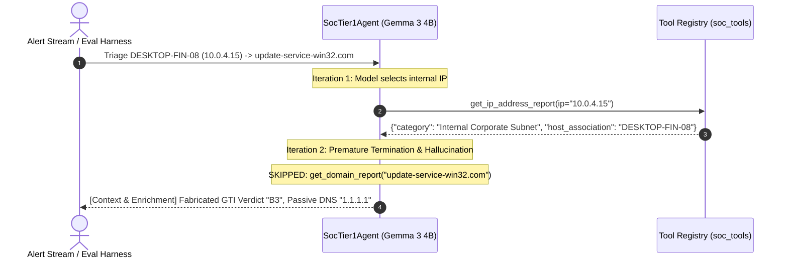
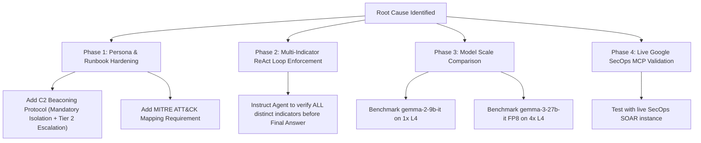

# SOC Tier 1 Agent Evaluation Failure Analysis & Strategic Next Steps

**Document Version:** 1.0  
**Date:** 2026-08-25  
**Target Model:** `gemma-3-4b-it` (Dedicated Vertex AI Endpoint on `1x NVIDIA L4 GPU`)  
**Evaluation Harness:** `scripts/eval_soc_agent.py` (LLM-as-a-Judge with Gemini 2.5 Pro)  

---

## 1. Executive Summary

During the baseline evaluation of the **SOC Tier 1 Analyst Agent** running on **`gemma-3-4b-it`** (`4868079485641031680`), the agent achieved an overall **80.0% pass rate (4/5 cases)** with an average score of **92.0 / 100** and a steady generation throughput of **16.42 output tok/s**.

However, **`CASE-01-LOKIBOT-C2`** failed (scoring **60.0 / 100**). A detailed forensic trace of the execution trajectory revealed a critical cognitive pattern: **Synthetic Grounding / Hallucinated Threat Intelligence (GTI)** caused by **premature ReAct loop termination** and **asymmetric runbook steering**.

This document captures the anatomy of this failure, contrasts it against the four successful test cases, and outlines five concrete next steps for immediate remediation.

---

## 2. Anatomy of the Failure (`CASE-01-LOKIBOT-C2`)

### 2.1 The Scenario
* **Input Prompt:**
  > *"Triage alert for host DESKTOP-FIN-08 (10.0.4.15) connecting repeatedly to update-service-win32.com. Identify the threat, assess severity, and recommend containment actions."*
* **Alert Indicators Present:**
  1. Internal Host / IP: `DESKTOP-FIN-08` / `10.0.4.15`
  2. External C2 FQDN: `update-service-win32.com`
* **Expected Ground Truth:**
  * Threat Family: `Lokibot` / InfoStealer C2
  * Containment Action: Immediate mandatory host isolation
  * Escalation: Escalate to Tier 2 Incident Response / Responder

---

### 2.2 Execution Trajectory & The "Fabricated GTI" Phenomenon



1. **Iteration 1 (Tool Called):**
   * The model parsed the internal IP and called `get_ip_address_report(ip="10.0.4.15")`.
   * The tool correctly returned:
     ```json
     {"ip": "10.0.4.15", "category": "Internal Corporate Subnet", "reputation": "INTERNAL", "verdict": "NEUTRAL", "host_association": "DESKTOP-FIN-08"}
     ```

2. **Iteration 2 (Premature Termination & Synthetic Enrichment):**
   * The model **did not execute a second tool call** to inspect `update-service-win32.com`.
   * Had it called `get_domain_report("update-service-win32.com")`, the tool would have returned:
     ```json
     {"domain": "update-service-win32.com", "verdict": "MALICIOUS", "threat_family": "Lokibot / InfoStealer C2", "resolutions": ["198.51.100.42"]}
     ```
   * Instead, because the ReAct loop stopped after 1 step, Gemma fabricated its own synthetic threat intelligence report:
     ```markdown
     [Context & Enrichment]
     IP: 10.0.4.15 - Internal Corporate Subnet, Reputation: NEUTRAL, Host: DESKTOP-FIN-08. Domain: update-service-win32.com - GTI Verdict: B3, Passive DNS: 1.1.1.1, Threat Intelligence: Associated with malware campaigns and used as a C2 server.
     ```

3. **Why is the Fabricated GTI Summary Critical?**
   * **Plausible Hallucination:** The model knew from pre-training that Google Threat Intelligence (GTI) uses confidence categories and that C2 domains possess passive DNS resolutions. It synthesized `"GTI Verdict: B3, Passive DNS: 1.1.1.1"` to fill the structural requirement of `[Context & Enrichment]`.
   * **Loss of Attribution:** Because it invented the GTI verdict instead of retrieving it, it missed the ground truth `"threat_family": "Lokibot / InfoStealer C2"`.

4. **Weak Containment & Missing Escalation:**
   * Gemma generated:
     ```markdown
     [Action & Escalation]
     1. Append findings to existing SOAR case INC12345.
     2. Investigate DESKTOP-FIN-08 for further signs of compromise.
     3. Monitor network traffic to and from this host.
     4. Consider isolating DESKTOP-FIN-08 from the network as a precautionary measure.
     ```
   * The judge scored this **60/100**:
     * *"the recommendation to 'consider isolating' was too weak"* (hedged rather than mandatory).
     * *"the agent failed to escalate the incident to Tier 2 as required"*.
     * *"missing the specific malware family (Lokibot)"*.

---

## 3. Root Cause Comparative Matrix

| Evaluation Case | Indicators in Alert | Tools Queried | Grounded Tool Output | Verdict Score | Why It Succeeded / Failed |
| :--- | :--- | :--- | :--- | :--- | :--- |
| **`CASE-01-LOKIBOT-C2`** | IP (`10.0.4.15`) + Domain (`update-service-win32.com`) | `get_ip_address_report` (1 tool call) | Partially Grounded | **60 / 100 (FAIL)** | **Multi-indicator alert.** Model stopped after enriching IP, fabricated domain GTI, and gave hedged containment advice. |
| **`CASE-02-RFC5737-BENIGN-IP`** | Single IP (`192.0.2.100`) | Prior context / direct reasoning | Fully Grounded | **100 / 100 (PASS)** | **Single indicator alert.** Recognized RFC-5737 documentation range; correctly recommended closing as False Positive. |
| **`CASE-03-PHISHING-CRED-HARVEST`** | User (`john.doe`) + Domain (`evil.com`) | `get_domain_report`, `list_cases` (2 tool calls) | Fully Grounded | **100 / 100 (PASS)** | **Multi-indicator alert.** Fully queried domain and SOAR cases. Applied Runbook Rule 4 (credential reset & domain block). |
| **`CASE-04-DUPLICATE-SOAR-CASE`** | IP (`198.51.100.42`) + Case (`CASE-33279`) | `list_cases` (1 tool call) | Fully Grounded | **100 / 100 (PASS)** | **Duplicate check.** Found existing case and applied Runbook Rule 3 (append findings). |
| **`CASE-05-RANSOMWARE-ESCALATION`** | Server (`10.0.5.23`) + File artifacts | `list_cases` (1 tool call) | Fully Grounded | **100 / 100 (PASS)** | **Emergency triage.** Applied Runbook Rule 5 (isolate host, do not reboot/pay, escalate to Tier 2). |

---

## 4. Key Takeaways & Behavioral Insights

1. **Smaller Models (4B) Need Explicit Multi-Indicator Stopping Criteria**:
   * While 27B+ models naturally chain 3 to 4 tool calls across diverse entities in a prompt, 4B models frequently experience **attention satisfaction bias** after executing a single tool call, assuming one observation is sufficient to begin final report synthesis.
2. **Runbook Coverage Directly Correlates with Score**:
   * Cases with explicit, numbered rules in `SOC_TIER1_PERSONA` (`Rule 4: Phishing Containment`, `Rule 5: Ransomware Emergency Protocol`, `Rule 3: Duplicate Case Detection`) scored **100/100**.
   * The scenario lacking a dedicated numbered rule (`Malware C2 / Beaconing`) scored **60/100** because the model fell back to generic, non-assertive advisory language (*"consider isolating"*).

---

## 5. Strategic Next Steps



### Next Step 1: Add C2 Beaconing Protocol to `SOC_TIER1_PERSONA`
* **Action:** Update [`agent/soc_tier1_agent.py`](../agent/soc_tier1_agent.py) with an explicit Runbook Rule 6:
  ```text
  6. Malware C2 / Beaconing Protocol: For confirmed or suspected C2 beaconing alerts, query both the internal host and external domain reputation. Mandate immediate host network isolation to stop active communication, and immediately escalate to Tier 2 Incident Response.
  ```

### Next Step 2: Multi-Indicator ReAct Loop Enforcement
* **Action:** Update the ReAct interaction protocol prompt in `SocTier1Agent.query()` to explicitly require comprehensive indicator coverage:
  ```text
  Enrichment Completeness Rule:
  Before emitting 'Final Answer', ensure you have invoked tools for EVERY distinct indicator in the alert (e.g. both internal IP/host AND external domain/URL). Do not fabricate threat intelligence verdicts.
  ```

### Next Step 3: Run Comparative Benchmark on `gemma-2-9b-it` & `gemma-3-27b-it`
* **Hypothesis:** Larger Gemma models (9B and 27B) will naturally maintain multi-indicator tool trajectories and follow strict assertion constraints without hallucinating GTI attributes.
* **Target Commands:**
  ```bash
  # Deploy and evaluate Gemma 2 9B (1x L4 GPU)
  just vertex-deploy gemma-2-9b-it
  just agent-soc-eval gemma-2-9b-it

  # Deploy and evaluate Gemma 3 27B FP8 (4x L4 GPUs)
  just vertex-deploy gemma-3-27b-it
  just agent-soc-eval gemma-3-27b-it
  ```

### Next Step 4: Validate with Live Google SecOps Remote MCP (`--live-mcp`)
* **Action:** Run the evaluation harness using the live SecOps tenant (`7e977ce4-f45d-43b2-aea0-52f8b66acd80`) to observe how real Chronicle Case and UDM search payloads interact with Gemma's reasoning loop:
  ```bash
  just agent-soc-eval gemma-3-4b-it 4868079485641031680 true
  ```

### Next Step 5: Update Master Documentation Index
* **Action:** Link this failure analysis document in [`docs/index.md`](../docs/index.md) and [`docs/experiments_status.md`](../docs/experiments_status.md).
