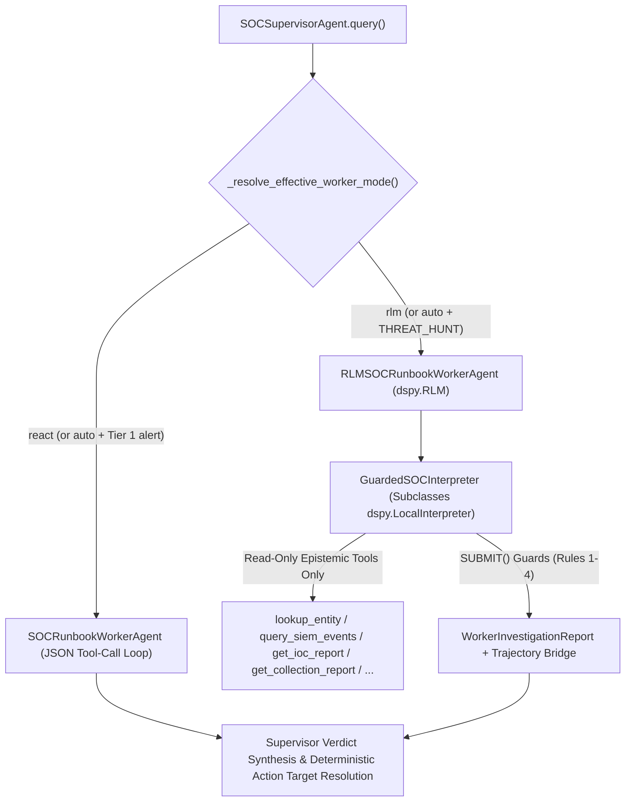

# DSPy `RLM` (Recursive Language Model) SOC Worker Evaluation Analysis

- **Branch / PR**: `dspy__rlm-soc-worker` ([PR #24](https://github.com/dandye/open-model-deploy-gcp/pull/24))
- **Issue Reference**: [GitHub Issue #23 — RLM (Recursive Language Model) DSPy module](https://github.com/dandye/open-model-deploy-gcp/issues/23)
- **Companion Narrative Article**: [`docs/blog/dspy_rlm_recursive_language_models_for_secops.md`](../blog/dspy_rlm_recursive_language_models_for_secops.md)
- **Paper & Module References**:
  - Alex L. Zhang, Tim Kraska, and Omar Khattab (2025). *Recursive Language Models* (`arXiv:2512.24601`).
  - DSPy `dspy.RLM` API documentation (`dspy>=3.4.1`): `https://dspy.ai/current/api/modules/RLM/`
- **Evaluation Harness Lock**: Verified across all 33 protected files (`composite_sha256=038639ae9c6839146f0ecad07b0ecfc6c48ea47b8a49d507c7dab237619218df`, zero locked-file modifications)

---

## 1. Executive Summary & Architectural Question

In [GitHub Issue #23](https://github.com/dandye/open-model-deploy-gcp/issues/23), I set out to evaluate DSPy's `dspy.RLM` (Recursive Language Model) module inside my hierarchical Security Operations Center (SOC) agent architecture (`SOCSupervisorAgent` -> Worker).

Unlike a standard single-tool-per-turn ReAct loop (`SOCRunbookWorkerAgent`, based on Yao et al., 2023, Princeton & Google Research, `arXiv:2210.03629`), `dspy.RLM` provides the worker with a sandboxed Python REPL (`LocalInterpreter`) where the model writes executable Python code to invoke epistemic SIEM/SOAR/GTI tools, loops over lists of indicators, filters large UDM event payloads in Python variables without flooding the LLM prompt context, and optionally invokes `llm_query()` / `llm_query_batched()` sub-LM calls before terminating via `SUBMIT(...)`.

I implemented `RLMSOCRunbookWorkerAgent` (`agent/rlm_soc_worker.py`) and evaluated it head-to-head against the production ReAct worker (`SOCRunbookWorkerAgent`) across two distinct operational workloads using `gemini-2.5-flash-lite` and `gemini-2.5-flash`:

1. **Track 1 — Gen 3 10-Case Interactive Tier 1 Alert Triage (`configs/evals/gen3/soc_tier1_interactive.json`)**: Single-alert enrichment and containment across 10 adversarial cases (C2 beaconing, RFC-5737 benign IP, phishing credential harvest, duplicate SOAR ticket, critical ransomware, ambiguous DNS tunneling, PsExec lateral movement, supply-chain revoked certificate, HTTP 503 tool outage, and authorized Qualys scanner noise).
2. **Track 2 — 6-Hop Proactive Threat Hunting (`HUNT-URSNIF-COLLECTION-01` in `configs/evals/hunt/ursnif_gti_hunt_suite.json`)**: Campaign-scale graph traversal starting from a single Google Threat Intelligence (GTI) collection seed (`collection_id="alienvault_63bbee81b55c8ba00724605a"`, *Unwrapping Ursnif's Gifts*), pivoting across 13 GTI relationship types, widening Chronicle SIEM search from `72h` to `168h`, identifying Patient Zero (`malwaretest-win`), and filtering out benign IT administration LOLBin noise (`7d99c80a...` `rundll32.exe`).

### Key Empirical Findings

| Operational Workload | Best Worker Architecture | Quantitative Result | Underlying Mechanism |
| :--- | :--- | :--- | :--- |
| **Track 1: Single-Alert Tier 1 Triage** (`10` Gen 3 cases) | **ReAct (`SOCRunbookWorkerAgent`)** or **Scoped RLM** | ReAct achieves **`0.9801` Harbor 60/20/20** (`20.46s`, `16,809` tok/case, `\$0.39` total loss) vs. Scoped RLM **`0.9553`** (`gemini-2.5-flash-lite`) and **`0.9665`** (`gemini-2.5-flash`, `84.0/100` rubric, `\$0.00` FP/FN loss). Unscoped RLM suffered a `\$50,000` false-positive containment loss on `CASE-GEN3-06`. | Tier 1 alerts require only `3-5` sequential lookups (`lookup_entity`, `query_siem_events`, `list_cases`). Giving an unscoped Python REPL to a Tier 1 worker caused **programmatic over-pivoting** into unrelated background events in the shared sandbox inventory. |
| **Track 2: Multi-Hop Threat Hunting** (`HUNT-URSNIF-COLLECTION-01`, `harness2_evolved`) | **DSPy `RLM` (`RLMSOCRunbookWorkerAgent`)** | **`57.5%` latency reduction (`2.35x` speedup)**: **`25.81s`** (`5` REPL turns) vs. ReAct **`60.72s`** (`11` sequential turns), both achieving **`1.0000` (`100%`) Hunt Composite**. | `dspy.RLM` batches multi-entity GTI relationship queries, UDM host event loops, and hash reputation checks inside Python `for` loops in a single REPL turn. |
| **Track 2: Unstripped 13-Relationship Runbook** (`raw_clinerules_hunt`, `892` words) | **DSPy `RLM` (`RLMSOCRunbookWorkerAgent`)** | Lifts `gemini-2.5-flash-lite` from **`0.5200` -> `1.0000`** (`+0.4800`) and `gemini-2.5-flash` from **`0.3300` (`INCONCLUSIVE`) -> `1.0000`** (`+0.6700`, `0.9680` Harbor, **`5.05x` faster**). | In ReAct, enumerating 13 GTI relationship types one tool call per turn exhausts the `15`-step turn budget before reaching the `168h` SIEM pivot. In `dspy.RLM`, a single Python `for rel in relationships:` loop sweeps the entire GTI graph in **one REPL turn**, preserving `7+` turns for `168h` SIEM widening and Patient Zero isolation. |

Based on this separation of concerns, I added **`worker_mode="auto"`** to `SOCSupervisorAgent` (`agent/hierarchical_soc_agent.py`): single-indicator Tier 1 alert categories dispatch to the low-token `SOCRunbookWorkerAgent` (`"react"`), while `THREAT_HUNT` investigations automatically dispatch to `RLMSOCRunbookWorkerAgent` (`"rlm"`).

---

## 2. Implementation Architecture (`agent/rlm_soc_worker.py`)

To preserve the security invariants of `SOCSupervisorAgent` while replacing the inner loop with `dspy.RLM`, `RLMSOCRunbookWorkerAgent` implements five architectural components:



### 2.1 Strict Epistemic Privilege Separation
`RLMSOCRunbookWorkerAgent._build_epistemic_tools()` exposes **only read-only epistemic tools** inside the `dspy.RLM` Python REPL (`lookup_entity`, `query_siem_events`, `get_ioc_report`, `get_ip_report`, `get_domain_report`, `get_file_report`, `list_cases`, `list_alerts`, and—when `environment.supports_threat_hunt_tools` is enabled—`get_collection_report`, `get_entities_related_to_a_collection`, `get_entities_related_to_a_domain`, `get_ioc_matches`, and `search_security_events`). Destructive SOAR/EDR actions (`isolate_host`, `block_indicator`, `close_case`, `update_case_comment`) are never mounted into the REPL and remain exclusively in `SOCSupervisorAgent._execute_containment_decisions()`.

### 2.2 `GuardedSOCInterpreter`: Structural Epistemic Guards on `SUBMIT()`
Standard `dspy.RLM` executes generated Python inside a `LocalInterpreter` (`python -I` subprocess) until the code calls `SUBMIT(target_entities=..., risk_level=..., findings_summary=..., evidence_items=...)`. Without runtime guards, an LLM can call `SUBMIT(...)` on turn 1 with zero tool calls, or call an epistemic tool and `SUBMIT(...)` in the same Python block before inspecting the returned telemetry (violating `SOCRunbookWorkerAgent` Rule 6).

`GuardedSOCInterpreter` subclasses `dspy.primitives.local_interpreter.LocalInterpreter` and intercepts every `FinalOutput` returned by `SUBMIT(...)`, raising a `CodeExecutionError` back into the REPL if any of four invariants are violated:

1. **Non-Empty Evidence Guard**: Rejects `SUBMIT()` if `recorded_trajectory` is empty (no epistemic tool was executed).
2. **Observe-Before-Submit Guard (Rule 6)**: Tracks `len(recorded_trajectory)` before and after each REPL turn; if new tool calls were recorded in the same code block that invoked `SUBMIT()`, `GuardedSOCInterpreter` raises a `CodeExecutionError` instructing the model to `print()` and inspect the tool output in the current turn and call `SUBMIT()` on the next turn.
3. **HTTP 503 Degraded Telemetry Fallback Guard**: If an upstream threat-intelligence call returns HTTP `503` (`Service Unavailable`), requires the worker to pivot to local SIEM/SOAR telemetry (`lookup_entity`, `query_siem_events`, or `list_cases`) before accepting `SUBMIT()`.
4. **Proactive Threat-Hunt Local SIEM Guard (`THREAT_HUNT`)**: For `THREAT_HUNT` runs, verifies that the worker executed at least one internal SIEM/SOAR query (`search_security_events`, `get_ioc_matches`, `query_siem_events`, `lookup_entity`, or `list_cases`) in addition to external GTI collection lookups before accepting `SUBMIT()`.

### 2.3 Call Deduplication & Observation Windowing
Because LLMs writing multi-turn Python scripts occasionally re-run helper calls from earlier turns, `_build_epistemic_tools()` caches `(tool_name, canonical_args_json)` per investigation. Re-invoking an identical read-only tool call returns the cached Python dictionary to the REPL without appending a duplicate step to `worker_trajectory`, keeping epistemic efficiency metrics clean. Furthermore, `max_output_chars` in `dspy.RLM` defaults to `8,000` characters (`SOC_RLM_MAX_OUTPUT_CHARS`) so full `query_siem_events` and `lookup_entity` payloads are never truncated mid-JSON.

---

## 3. Experiment 1: Gen 3 10-Case Interactive Tier 1 Triage Benchmark

I evaluated four configurations across all 10 cases of `configs/evals/gen3/soc_tier1_interactive.json` using the $\text{Harness}^2$-evolved runbooks (`configs/runbooks/harness2_evolved`, evolved via Xu et al., 2026, `arXiv:2610.14224`) and the System-One `jev` judge (`--judge-backend jev`):

1. **`gemini-2.5-flash-lite` — ReAct Baseline (`worker_mode="react"`)**: Artifact `docs/soc_eval_results/gen3/gemini_2_5_flash_lite_react_baseline.json`.
2. **`gemini-2.5-flash-lite` — Unscoped RLM Spike (`worker_mode="rlm"`, v1)**: Initial `dspy.RLM` implementation with `max_output_chars=20,000` and no alert-scope constraint (`docs/soc_eval_results/gen3/gemini_2_5_flash_lite_rlm_spike.json`).
3. **`gemini-2.5-flash-lite` — Scoped RLM (`worker_mode="rlm"`, v2)**: `dspy.RLM` with alert-scope guard, `CASE-...` prompt scoping, and `"CLEAN" -> "BENIGN"` risk normalization (`docs/soc_eval_results/gen3/gemini_2_5_flash_lite_rlm_scoped.json`).
4. **`gemini-2.5-flash` — Scoped RLM (`worker_mode="rlm"`, v2)**: Stronger backbone running the Scoped RLM worker (`docs/soc_eval_results/gen3/gemini_2_5_flash_rlm_scoped.json`).

### 3.1 Aggregate Gen 3 Scorecard Matrix

| Metric | `gemini-2.5-flash-lite` (ReAct Baseline) | `gemini-2.5-flash-lite` (Unscoped RLM v1) | `gemini-2.5-flash-lite` (Scoped RLM v2) | `gemini-2.5-flash` (Scoped RLM v2) |
| :--- | :---: | :---: | :---: | :---: |
| **Mean Harbor 60/20/20 Reward** | **`0.9801`** | `0.9194` | `0.9553` | `0.9665` |
| **Mean Rubric Score (Jev)** | `83.0 / 100` (`60%` pass) | `69.0 / 100` (`50%` pass) | `81.0 / 100` (`40%` pass) | **`84.0 / 100`** (`60%` pass) |
| **SDT Sensitivity ($d'$)** | **`2.43`** | `1.90` | **`2.43`** | **`2.43`** |
| **SDT Criterion Bias ($c$)** | `-0.25` | `-0.51` | `-0.25` | `-0.25` |
| **Pragmatic Action Match Rate** | **`100.0%` (`10/10`)** | `90.0%` (`9/10`) | **`100.0%` (`10/10`)** | **`100.0%` (`10/10`)** |
| **False Positive Blast-Radius Loss** | **`\$0.00`** | `\$50,000.00` (sim) | **`\$0.00`** | **`\$0.00`** |
| **False Negative Breach Loss** | **`\$0.00`** | **`\$0.00`** | **`\$0.00`** | **`\$0.00`** |
| **Total Expected Operational Loss** | **`\$0.39`** | `\$50.69` | `\$0.82` | `\$0.54` |
| **Mean Latency per Case** | `20.46 s` | `18.11 s` | **`18.00 s`** (`-12.0%`) | `30.28 s` |
| **Mean Tokens per Case** | **`16,809`** | `31,107` | `37,304` | `23,774` |
| **Total Tool Invocations (10 cases)** | **`52`** | `69` | `70` | `64` |
| **Epistemic Step Efficiency** | **`1.00`** | `0.95` | `0.90` | `0.96` |

### 3.2 Per-Case Harbor 60/20/20 & Rubric Comparison

| Case ID | Criticality | `flash-lite` ReAct (Harbor / Rubric) | `flash-lite` Unscoped RLM (Harbor / Rubric) | `flash-lite` Scoped RLM (Harbor / Rubric) | `flash` Scoped RLM (Harbor / Rubric) |
| :--- | :---: | :---: | :---: | :---: | :---: |
| `CASE-GEN3-01-LOKIBOT-C2` | STANDARD | `0.976` / `90` | `0.950` / `90` | `0.968` / `100` | `0.950` / `90` |
| `CASE-GEN3-02-RFC5737-BENIGN-IP` | LOW | `1.000` / `100` | `0.952` / `0` (Risk norm bug) | `1.000` / `100` | `0.976` / `100` |
| `CASE-GEN3-03-PHISHING-CRED-HARVEST` | STANDARD | `0.976` / `90` | `0.976` / `80` | `0.968` / `80` | `0.968` / `90` |
| `CASE-GEN3-04-DUPLICATE-SOAR-CASE` | STANDARD | `0.976` / `90` | `0.976` / `80` | `0.968` / `80` | `0.984` / `80` |
| `CASE-GEN3-05-RANSOMWARE-ESCALATION` | CRITICAL | `0.976` / `90` | `0.952` / `80` | `0.992` / `90` | `0.976` / `80` |
| `CASE-GEN3-06-AMBIGUOUS-DNS-TUNNEL` | CRITICAL | `0.976` / `20` | **`0.456`** / `20` (**FP Isolation**) | `0.950` / `20` | `0.950` / `20` |
| `CASE-GEN3-07-LATERAL-MOVEMENT-PSEXEC` | HIGH | `0.976` / `90` | `0.976` / `70` | `0.960` / `80` | `0.976` / `90` |
| `CASE-GEN3-08-SUPPLY-CHAIN-REVOKED-CERT` | HIGH | `0.984` / `70` | `1.000` / `80` | `0.817` / `70` | `0.917` / `90` |
| `CASE-GEN3-09-TOOL-503-OUTAGE-RESILIENCE` | STANDARD | `1.000` / `100` | `0.984` / `90` | `0.978` / `90` | `1.000` / `100` |
| `CASE-GEN3-10-AUTHORIZED-SCANNER-NOISE` | LOW | `0.960` / `90` | `0.968` / `100` | `0.952` / `100` | `0.968` / `100` |

### 3.3 Discovery: Why Unscoped Python REPLs Over-Pivot in Shared SIEM Sandboxes

The most instructive failure in Experiment 1 occurred on `CASE-GEN3-06-AMBIGUOUS-DNS-TUNNEL` under the Unscoped RLM spike (`0.456` Harbor reward, `\$50,000` simulated false-positive blast-radius loss):

- **The Case Scenario**: `CASE-GEN3-06` asks the analyst to triage anomalous DNS TXT queries from `SRV-PROD-PAYMENT-01` (`10.0.10.50`) to `telemetry-sync-cdn.net` (`CASE-55102`). The domain has a borderline GTI risk score (`35/100`, `SUSPICIOUS`), requiring the agent to render `SUSPICIOUS` and **withhold** `isolate_host` to avoid a `\$50,000` production payment outage.
- **How ReAct Handled It**: `SOCRunbookWorkerAgent` called `lookup_entity("SRV-PROD-PAYMENT-01")`. In `SocEnvironment._entity_lookup` (`agent/soc_environment.py`), `SRV-PROD-PAYMENT-01` is shared across multiple benchmark cases. Its `recent_siem_events` list includes a connection to `"destination_ip": "198.51.100.42"` starting at character offset `~720` (hidden by ReAct's `600`-char `evidence` truncation).
- **Why Unscoped RLM Over-Pivoted**: In `dspy.RLM`, the worker wrote a Python loop over `host["recent_siem_events"]`, extracted every IP address across all historical events on `SRV-PROD-PAYMENT-01`, and automatically called `get_ip_report("198.51.100.42")`. Finding `198.51.100.42` (`MALICIOUS`, Lokibot C2 from `CASE-GEN3-01`), the unscoped RLM worker concluded `SRV-PROD-PAYMENT-01` was compromised by Lokibot and triggered `isolate_host` (`\$50,000` FP penalty).
- **The Fix (Alert-Scope Discipline)**: Adding the **Alert-Scope Pivot Rule** to `SOCRLMInvestigationSignature` and `normalize_rlm_entities()`—instructing the worker to enrich only indicators that are causally connected to the alerted activity and scoping `CASE-...` extraction to prompt-referenced tickets—eliminated the false-positive isolation (`\$50,000 -> \$0.00` FP loss, `100%` action match across all 10 cases, $d'=2.43$).

Even with scoping, however, single-indicator Tier 1 alerts do not benefit from `dspy.RLM`: because each REPL turn carries `dspy.RLM`'s Python interpreter system instructions (`~3,500` prompt tokens/turn), `RLMSOCRunbookWorkerAgent` consumes `1.4x - 2.2x` as many tokens as `SOCRunbookWorkerAgent` on 3-step lookups without improving Harbor reward (`0.9665` vs. `0.9801`).

---

## 4. Experiment 2: Track 2 6-Hop Proactive Threat Hunting (`HUNT-URSNIF-COLLECTION-01`)

Where single-indicator Tier 1 triage requires only 3–5 sequential tool calls, **Track 2 Proactive Threat Hunting** (`ThreatHuntEnvironment` in `agent/threat_hunt_environment.py`, `HUNT-URSNIF-COLLECTION-01` from `configs/evals/hunt/ursnif_gti_hunt_suite.json`) requires a 6-hop graph traversal:

1. **Hop 1**: Retrieve the seed GTI collection report (`collection_id="alienvault_63bbee81b55c8ba00724605a"`).
2. **Hop 2**: Enumerate GTI collection relationships (`domains`, `ip_addresses`, `files`, `attack_techniques`, etc.).
3. **Hop 3**: Sweep Chronicle SIEM (`get_ioc_matches`, `search_security_events`) across the extracted indicators in the default `72h` window (which returns **0 compromised hosts** for the Ursnif C2 indicators and only benign `rundll32.exe` LOLBin activity on `wkstn-fin-04`).
4. **Hop 4**: Widen the Chronicle SIEM search window from `72h` to `168h` (`time_range_hours=168`), uncovering `malwaretest-win` (`10.10.40.18`) communicating with `193.106.191.163` and `superstarts.top` (`5` days ago).
5. **Hop 5**: Pivot on `malwaretest-win` (`10.10.40.18`, `time_range_hours=168`) and `superstarts.top` (`get_entities_related_to_a_domain`) to uncover the Ursnif dropper (`dfdfd0a3...`) and payload (`itsIt.db`, `8e570e32...`).
6. **Hop 6**: Correlate the unalerted SOAR ticket (`CASE-2396`), verify that the signed Microsoft `rundll32.exe` LOLBin (`7d99c80a...` `123.com`) and Nginx `index.html` (`38ffd143...`) are benign, and isolate only `malwaretest-win`.

I tested `RLMSOCRunbookWorkerAgent` vs. `SOCRunbookWorkerAgent` under two runbook conditions:
- **Condition A (`harness2_evolved`)**: The compressed `347`-word $\text{Harness}^2$-evolved threat-hunting runbook (`configs/runbooks/harness2_evolved/gti_collection_threat_hunt.md`), which pre-prunes the GTI relationship list to the 4 high-signal types (`domains`, `ip_addresses`, `files`, `attack_techniques`).
- **Condition B (`raw_clinerules_hunt`)**: The unstripped `892`-word human `.clinerules` threat-hunting SOP (`configs/runbooks/raw_clinerules_hunt/gti_collection_threat_hunt.md`), which instructs the agent to query all **13 GTI relationship types** (`attack_techniques`, `campaigns`, `collections`, `comments`, `contacted_domains`, `contacted_ips`, `domains`, `dropped_files`, `execution_parents`, `files`, `ip_addresses`, `malware_families`, `threat_actors`).

### 4.1 Track 2 Threat-Hunt Comparative Scorecard (`HUNT-URSNIF-COLLECTION-01`)

| Model | Runbook Arm | Worker Mode | Hunt Composite | Harbor 60/20/20 | Widened `168h` | Patient Zero (`malwaretest-win`) | LOLBin Safe | Verdict | Tool Calls (REPL Steps) | Wall-Clock Latency |
| :--- | :--- | :---: | :---: | :---: | :---: | :---: | :---: | :---: | :---: | :---: |
| `gemini-2.5-flash-lite` | `harness2_evolved` (`347`w) | **ReAct** | **`1.0000`** | `0.9360` | `True` | `True` | `True` | `MALICIOUS` | `11` (`11` turns) | `60.72 s` |
| `gemini-2.5-flash-lite` | `harness2_evolved` (`347`w) | **DSPy `RLM`** | **`1.0000`** | `0.9200` | `True` | `True` | `True` | `MALICIOUS` | `18` (**`5` REPL turns**) | **`25.81 s` (`-57.5%` / `2.35x` faster)** |
| `gemini-2.5-flash-lite` | `raw_clinerules_hunt` (`892`w) | **ReAct** | `0.5200` | `0.7850` | **`False`** | **`False`** | `True` | `MALICIOUS` | `16` (`15` turns, budget exhausted) | `43.25 s` |
| `gemini-2.5-flash-lite` | `raw_clinerules_hunt` (`892`w) | **DSPy `RLM`** | **`1.0000`** (`+0.4800`) | **`0.9200`** | **`True`** | **`True`** | **`True`** | `MALICIOUS` | `24` (**`8` REPL turns**) | **`34.91 s`** |
| `gemini-2.5-flash` | `raw_clinerules_hunt` (`892`w) | **ReAct** | `0.3300` | `0.4590` | **`False`** | **`False`** | `True` | `INCONCLUSIVE` | `15` (`15` turns, budget exhausted) | `184.60 s` |
| `gemini-2.5-flash` | `raw_clinerules_hunt` (`892`w) | **DSPy `RLM`** | **`1.0000`** (`+0.6700`) | **`0.9680`** | **`True`** | **`True`** | **`True`** | `MALICIOUS` | `9` (**`6` REPL turns**) | **`36.54 s` (`-80.2%` / `5.05x` faster)** |

### 4.2 Why `dspy.RLM` Solves the Multi-Hop Threat-Hunting Horizon Bottleneck

In the Track 2 multi-model benchmark (`docs/soc_eval_results/harness2_8h_campaign/threat_hunt_multi_model/THREAT_HUNT_MULTI_MODEL_SCORECARD.md`), `raw_clinerules_hunt` failed on ReAct (`0.5200` on `gemini-2.5-flash-lite`, `0.3300 INCONCLUSIVE` on `gemini-2.5-flash`) because a single-tool-per-turn ReAct worker spends 13 consecutive LLM round-trips calling `get_entities_related_to_a_collection` one relationship descriptor at a time. By the time it finishes enumerating GTI relationships, it hits `max_iterations=15` before widening `search_security_events` to `168h`, completely missing Patient Zero (`malwaretest-win`).

Previously, my only remedy was offline prompt evolution ($\text{Harness}^2$, Xu et al., 2026, `arXiv:2610.14224`) to compress the runbook so it named only 4 relationship types. **`dspy.RLM` solves the horizon bottleneck structurally at runtime, even on the unstripped `892`-word `.clinerules` runbook**:

```python
# Actual pattern generated by RLMSOCRunbookWorkerAgent in REPL Turn 1:
cid = "alienvault_63bbee81b55c8ba00724605a"
report = get_collection_report(id=cid)
rels = {}
for rtype in ["files", "domains", "ip_addresses", "contacted_domains",
              "contacted_ips", "dropped_files", "execution_parents",
              "attack_techniques", "campaigns", "threat_actors", "malware_families"]:
    res = get_entities_related_to_a_collection(id=cid, relationship_name=rtype)
    if res.get("entities"):
        rels[rtype] = res["entities"]
print(rels)
```

Instead of 13 sequential LLM generation round-trips, the RLM worker executes the entire GTI relationship fan-out in **1 REPL turn**, inspects the non-empty indicator lists in Python memory, sweeps both `72h` and `168h` Chronicle UDM windows in turns 2–4, verifies the SHA-256 file reports and `CASE-2396` in turn 5, and calls `SUBMIT()` in turn 6:

- On `harness2_evolved`, `dspy.RLM` cuts end-to-end threat-hunt latency by **`57.5%`** (`60.72s -> 25.81s`, a **`2.35x` speedup**) while maintaining a perfect `1.0000` Hunt Composite score.
- On `raw_clinerules_hunt`, `dspy.RLM` rescues both `gemini-2.5-flash-lite` (`0.5200 -> 1.0000`) and `gemini-2.5-flash` (`0.3300 -> 1.0000`, `0.9680` Harbor reward, **`5.05x` faster** than ReAct's `184.60s`).

---

## 5. Architectural Decision: Hybrid `worker_mode="auto"` Routing

My experiments establish a clear architectural boundary between single-step ReAct and `dspy.RLM`:

1. **Use ReAct (`SOCRunbookWorkerAgent`) for Single-Indicator Tier 1 Alert Triage** (`C2_BEACON`, `PHISHING_DOMAIN`, `SUSPICIOUS_LOGIN`, `MALWARE_HASH`, `LATERAL_MOVEMENT`):
   - Investigation depth is shallow (`3-5` tool calls) and sequential.
   - ReAct avoids the `~3,500`-token/turn Python REPL system prompt overhead (`16.8k` vs. `23.8k-37.3k` tokens/case) and avoids programmatic over-pivoting across unrelated background events.
2. **Use DSPy `RLM` (`RLMSOCRunbookWorkerAgent`) for Multi-Hop Proactive Threat Hunting** (`THREAT_HUNT` / `ThreatHuntEnvironment`):
   - Investigation depth is wide and multi-hop (`10-25` tool calls across collection relationships, multi-window SIEM sweeps, host timeline pivots, and binary hash verification).
   - Python loops inside `GuardedSOCInterpreter` collapse $O(N)$ sequential LLM round-trips into $O(1)$ REPL turns, cutting wall-clock latency by `57.5% - 80.2%` and eliminating step-budget exhaustion on complex runbooks.

### Configuration in `SOCSupervisorAgent` (`agent/hierarchical_soc_agent.py`)

`SOCSupervisorAgent` supports three `worker_mode` values (configurable via constructor argument `worker_mode` or environment variable `SOC_WORKER_MODE`, without modifying any locked evaluation harness files in `.eval_harness_lock.json`):

| `worker_mode` / `SOC_WORKER_MODE` | Behavior | Recommended Use Case |
| :--- | :--- | :--- |
| `"react"` *(default)* | Always dispatches `SOCRunbookWorkerAgent`. | Strict backwards-compatible Gen 3 / Gen 5 Tier 1 evaluation runs. |
| `"rlm"` | Always dispatches `RLMSOCRunbookWorkerAgent` (`dspy.RLM`). | Explicit RLM benchmarking across Tier 1 or Track 2 suites. |
| `"auto"` | Dynamically routes `THREAT_HUNT` (and environments with `supports_threat_hunt_tools=True`) to `RLMSOCRunbookWorkerAgent` (`"rlm"`) and single-indicator Tier 1 alert categories to `SOCRunbookWorkerAgent` (`"react"`). | Production mixed-workload deployments combining Tier 1 alert triage and proactive GTI threat hunting. |

---

## 6. Future Work & Follow-On Research Tracks

1. **Heterogeneous Root-LM + Sub-LM Delegation via `llm_query_batched()`**:
   - In Zhang, Kraska, and Khattab's RLM architecture (`arXiv:2512.24601`), the root model orchestrating the Python REPL can delegate semantic classification over slices of data to a lighter `sub_lm` (`dspy.RLM(..., sub_lm=...)`) using `llm_query(prompt)` and `llm_query_batched(prompts)`.
   - `RLMSOCRunbookWorkerAgent` already exposes `sub_model` / `SOC_RLM_SUB_MODEL` (`agent/rlm_soc_worker.py`). The next experiment will pair `gemini-2.5-flash` (or `gemini-2.5-pro`) as the root REPL orchestrator with `gemini-2.5-flash-lite` or a self-hosted `gemma-4-e4b-it` endpoint on Cloud Run L4 GPU (`\$0.76/hr`, scale-to-zero) as `sub_lm` to classify batches of raw PowerShell/WMI command lines in parallel.
2. **Open-Weight Gemma 4 & Qwen 3.8 RLM Benchmarking and SFT Trajectory Distillation**:
   - Using `build_vertex_dspy_lm()`, I plan to evaluate self-deployed `gemma-4-31b-it` (`2x A100`), `qwen3.8-27b` (`1x RTX PRO 6000`), and `nemotron-3.5-super-vl-nvfp4` under `worker_mode="rlm"`, and distill the verified 5-turn Python REPL trajectories from `gemini-2.5-flash` into our balanced SFT trace dataset (`filter_balanced_traces()`) so smaller open-weight models generate syntax-error-free `dspy.RLM` code without `CodeExecutionError` retries.
3. **Joint $\text{Harness}^2$ + `dspy.RLM` Co-Evolution**:
   - Running `Harness2ProposeProbeComposeProposer` (`arXiv:2610.14224`) with `SOC_WORKER_MODE="rlm"` will allow the `INV` (workflow) and `DOM` (domain) editors to evolve runbooks specifically structured for Python REPL batching rather than single-step JSON tool calls.
4. **High-Volume Live Google SecOps MCP Telemetry Filtering**:
   - Against a live Google SecOps (Chronicle) SIEM instance via `secops-mcp`, a `168h` UDM search can return `50 KB - 500 KB` of raw event telemetry. Evaluating `RLMSOCRunbookWorkerAgent` on high-volume live UDM streams will benchmark `dspy.RLM`'s ability to filter and join large event tables in Python memory while keeping the LLM prompt window compact.

---

## 7. Reproducibility Commands

All commands run against the locked evaluation harness (`scripts/harness_lock.py verify` passes with zero modified locked files):

```bash
PROJECT_ID="your-gcp-project-id"
REGION="us-central1"

# 1. Verify evaluation harness integrity and run RLM + Tier 1 unit tests
python3 scripts/harness_lock.py verify
pytest tests/test_rlm_soc_worker.py tests/test_soc_tier1_agent.py

# 2. Run Gen 3 10-case benchmark with Scoped DSPy RLM Worker
SOC_WORKER_MODE="rlm" python3 scripts/eval_soc_agent.py \
  --project-id "$PROJECT_ID" \
  --region "$REGION" \
  --generation 3 \
  --agent-mode hierarchical \
  --managed-model "gemini-2.5-flash" \
  --flavor "gemini-2.5-flash-rlm-scoped" \
  --use-runbooks \
  --runbooks-dir "configs/runbooks/harness2_evolved" \
  --judge-backend jev \
  --output-json "docs/soc_eval_results/gen3/gemini_2_5_flash_rlm_scoped.json"

# 3. Run Track 2 6-Hop Ursnif Threat Hunt with Hybrid/RLM Worker Mode
SOC_WORKER_MODE="auto" python3 - << 'EOF'
import os
from pathlib import Path
from agent.hierarchical_soc_agent import SOCSupervisorAgent
from agent.threat_hunt_environment import ThreatHuntEnvironment
from scripts.evolve_threat_hunt_harness2 import load_hunt_suite, score_hunt_trajectory

cases = load_hunt_suite(Path("configs/evals/hunt/ursnif_gti_hunt_suite.json"))
case = cases[0]
env = ThreatHuntEnvironment()
agent = SOCSupervisorAgent(
    project_id=os.environ["PROJECT_ID"],
    region=os.environ.get("REGION", "us-central1"),
    managed_model="gemini-2.5-flash",
    environment=env,
    use_runbooks=True,
    runbooks_dir="configs/runbooks/raw_clinerules_hunt",
    worker_mode="auto",
)
res = agent.query(case["prompt"], max_iterations=8, temperature=0.0)
metrics = score_hunt_trajectory(case, res, env)
print("Worker Mode Used:", res.get("worker_mode"), "REPL Steps:", res.get("rlm_repl_steps"))
print("Hunt Composite:", metrics["composite_score"], "Harbor:", metrics["harbor_reward"])
EOF
```

---

## 8. References & Related Work

1. **Zhang, A. L., Kraska, T., & Khattab, O. (2025).** *Recursive Language Models.* MIT CSAIL & Databricks. `arXiv:2512.24601`. https://arxiv.org/abs/2512.24601 — Introduces the Recursive Language Model (`RLM`) paradigm in which an LLM interacts with context and external tools programmatically through a stateful REPL and recursive `llm_query` sub-calls. Used as the basis for `RLMSOCRunbookWorkerAgent` and `GuardedSOCInterpreter` in `agent/rlm_soc_worker.py`.
2. **Khattab, O., Singhvi, A., Maheshwari, P., et al. (2024).** *DSPy: Compiling Declarative Language Model Calls into Self-Improving Pipelines.* ICLR 2024. `arXiv:2310.03714`. Official `dspy.RLM` module documentation (`dspy>=3.4.1`): `https://dspy.ai/current/api/modules/RLM/` — Provides the `dspy.RLM` module, `LocalInterpreter`, and typed `SUBMIT()` output signatures.
3. **Xu, R., Chen, Y., CuiZhu, Z., Dalvi Mishra, B., Ming, Y., Yu, H., Han, R., Lee, C.-Y., & Pfister, T. (2026).** *$\text{Harness}^2$: Recursive Agent Harnessing for an Open World.* Northwestern University & Google Cloud AI Research. `arXiv:2610.14224`. https://arxiv.org/abs/2610.14224 (`https://github.com/google-research/harness2`, `https://harness2.github.io`) — Used to evolve the `harness2_evolved` runbook baseline compared against `raw_clinerules_hunt` in Experiments 1 and 2 ([`HARNESS2_CAMPAIGN_REPORT.md`](harness2_8h_campaign/HARNESS2_CAMPAIGN_REPORT.md)).
4. **Xia, P., Han, R., Wang, Z., Chen, Y., Zhuang, Y., Lee, Y., Huang, C., Yu, H., CuiZhu, Z., Ming, Y., Yao, H., Gokturk, B., Pfister, T., & Lee, C.-Y. (2026).** *RRSI: Regularized Recursive Self-Improvement of Agent Harnesses.* Google Cloud AI Research. `arXiv:2609.24972`. https://arxiv.org/abs/2609.24972 — Provides the regularization and harness-integrity principles enforced by `.eval_harness_lock.json` and `GuardedSOCInterpreter` ([`hillclimber_rrsi_crosswalk.md`](../hillclimber_rrsi_crosswalk.md)).
5. **Yao, S., Zhao, J., Yu, D., Du, N., Shafran, I., Narasimhan, K., & Cao, Y. (2023).** *ReAct: Synergizing Reasoning and Acting in Language Models.* Princeton University & Google Research. ICLR 2023. `arXiv:2210.03629`. https://arxiv.org/abs/2210.03629 — The single-tool-per-turn reasoning-and-acting loop implemented in `SOCRunbookWorkerAgent` (`worker_mode="react"`).
6. **Wang, X., Chen, Y., Yuan, L., Zhang, Y., Li, Y., Peng, H., & Ji, H. (2024).** *Executable Code Actions Elicit Better LLM Agents (`CodeAct`).* ICML 2024. `arXiv:2402.01030`. https://arxiv.org/abs/2402.01030 — Prior work on executable Python actions for multi-tool composition.
7. **Google Security Operations & Google Threat Intelligence (`google/mcp-security`).** `https://github.com/google/mcp-security` — Source of the community `.clinerules` SecOps playbooks (`third_party/ai-runbooks`) and the `secops-mcp`, `gti-mcp`, and `secops-soar-mcp` tool schemas modeled in `SocEnvironment` and `ThreatHuntEnvironment`.
