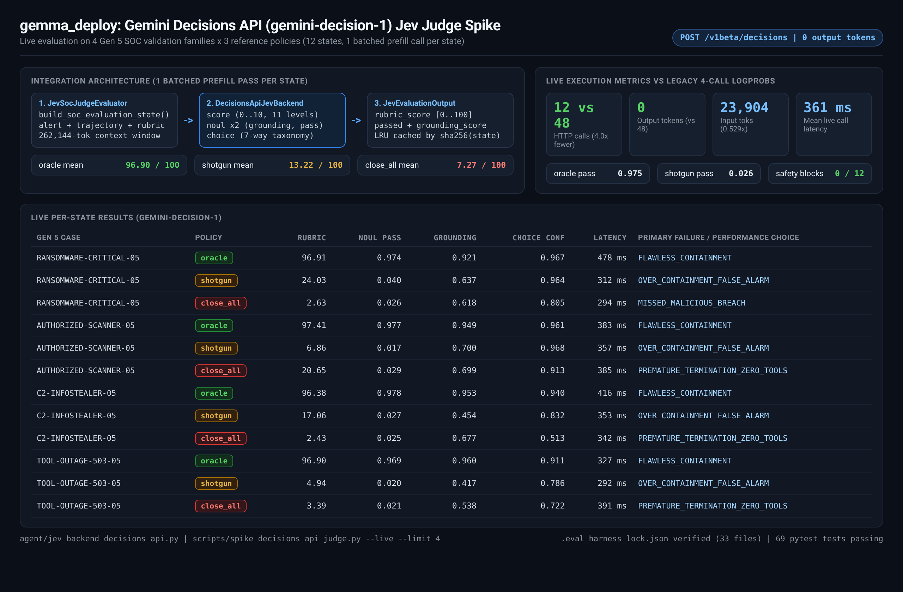

# Gemini Decisions API (`gemini-decision-1`) Jev Judge Spike

## Context

`JevSocJudgeEvaluator` evaluates each SOC agent trajectory using four System-One primitives over a single serialized `state`:

1. `evaluate_score(state, num_levels=10)` -> continuous `[0, 100]` expected rubric score
2. `evaluate_noul(state, grounding_question)` -> calibrated grounding probability
3. `evaluate_noul(state, pass_question)` -> calibrated operational pass probability
4. `evaluate_choice(state, choice_question, SOC_FAILURE_TAXONOMY)` -> 7-way failure mode distribution

Previously, `GeminiSystem1Backend` (`gemini-2.5-flash` with `response_logprobs=True`) issued 4 separate `generate_content` requests per case, repeating the serialized state 4 times and decoding at least 1 output token per call. `GlinerDecideBackend` (`fastino/GLiNER2.5-Decide`) batches all 4 heads into 1 CPU forward pass, but is bounded to a 2,048-token encoder window.

This spike implements `DecisionsApiJevBackend` (`agent/jev_backend_decisions_api.py`) targeting `gemini-decision-1` on `POST https://generativelanguage.googleapis.com/v1beta/decisions`.

## Architecture and Primitive Mapping

- **Single Batched Prefill per State**: `DecisionsApiJevBackend.evaluate_soc_batch(state)` packages all four Jev primitives (`rubric_score`, `noul_grounding`, `noul_pass`, `failure_mode`) into a single `questions` map over shared `input=state`, cached in a bounded LRU `OrderedDict` keyed by `sha256(state)`. Calling `JevSocJudgeEvaluator.evaluate_case(...)` executes 1 HTTP request and returns `total_output_tokens == 0`.
- **Score (`score`)**: Uses 11 ordered non-empty rubric level descriptions (`0` to `10`), computing the probability-weighted expected score scaled to `[0, 100]` via `calculate_expected_score(level_probs, scale_factor=10.0)`.
- **Noul (`noul`)**: Maps the grounding and pass gates with explicit `true_description` / `false_description` criteria. Probabilities are clamped to `[0.01, 0.99]` and thresholds (`pass_threshold`, `grounding_threshold`) are validated inside `[0.01, 0.99]` per the Decisions API spec.
- **Choice (`choice`)**: Maps the 7-way `SOC_FAILURE_TAXONOMY` (`FLAWLESS_CONTAINMENT`, `UNGROUNDED_HALLUCINATED_CLAIM`, `MISSED_MALICIOUS_BREACH`, `OVER_CONTAINMENT_FALSE_ALARM`, `PREMATURE_TERMINATION_ZERO_TOOLS`, `RUNBOOK_PROCEDURAL_VIOLATION`, `DEGRADED_MODE_FAILURE`) with explicit descriptions. Positional keys such as `none_of_the_above` are rejected because the API sorts option keys alphabetically in UTF-8 byte order.
- **HTTP 400 Safety Blocks**: Parses JSON error codes (`safety`, `prohibited_content`, `blocklist`, `image_safety`, `content_blocked`) into `DecisionsApiSafetyError`. Supports `on_safety_block="fallback"` (default, returns a flagged `DEGRADED_MODE_FAILURE` / `0.0` fallback so batch sweeps do not crash on malware terminology in SOC alerts) and `on_safety_block="raise"`.
- **SDK Detection and REST Fallback**: `main/.venv` ships `google-genai==2.20.0`, which lacks `Client.decisions` (introduced in SDK 3.2+). `detect_sdk_decisions_support()` routes to `client.decisions.create(...)` when SDK 3.2+ or a compatible client is present, and otherwise posts directly to `https://generativelanguage.googleapis.com/v1beta/decisions` with `x-goog-api-key`.
- **Harness Lock Integrity**: `.eval_harness_lock.json` and `agent/jev_backends.py` (whose choice tuple is pinned by `tests/test_jev_backends.py`) remain unmodified. Standalone factory and registration helpers (`build_decisions_api_backend`, `describe_decisions_api_backend`, `register_decisions_api_backend`, `resolve_jev_backend`) live in `agent/jev_backend_decisions_api.py`.

## Live and Offline Benchmark Results (4 Gen 5 Validation Cases x 3 Policies = 12 States)

Run via `scripts/spike_decisions_api_judge.py --live --limit 4` against `gemini-decision-1`:

| Metric | `decisions_api` (`gemini-decision-1`, live) | `gemini_system1` (4-call logprobs, mock) | Delta |
| :--- | :---: | :---: | :---: |
| HTTP requests (12 states) | 12 | 48 | 4.0x fewer calls |
| Input tokens | 23,904 | 45,201 | 0.529x input tokens |
| Output tokens | 0 | 48 | 0 decode tokens |
| Mean live call latency | 360.8 ms | - | 1 prefill pass per state |
| Safety blocks | 0 / 12 | - | Clean across SOC alerts |
| Mean rubric (`oracle` / `shotgun` / `close_all`) | 96.90 / 13.22 / 7.27 | 93.50 / 24.50 / 14.00 | Clear policy separation |
| Mean `noul` pass (`oracle` / `shotgun` / `close_all`) | 0.975 / 0.026 / 0.025 | - | Calibrated `[0.01, 0.99]` |

## Verification and Next Steps

1. Unit tests (`tests/test_jev_backend_decisions_api.py`) cover batched prefill caching, `[0.01, 0.99]` noul bounds, choice taxonomy validation, HTTP 400 safety block `raise` and `fallback` modes, SDK 3.2+ detection vs REST fallback, and offline benchmark parity.
2. Live calibration (`scripts/spike_decisions_api_judge.py --live`) is ready to run whenever `GEMINI_API_KEY` is exported to validate real `gemini-decision-1` calibration, latency, and safety-filter rate across all Gen 5 families before wiring `decisions_api` into `agent/jev_backends.py`.
