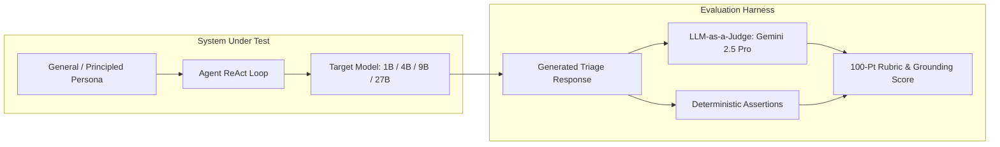

# Thoughts on Agent Evaluation: Benchmarks as Capability Discriminators

**Author:** dandye  
**Date:** 2026-08-26  
**Context:** Gemma SOC Tier 1 Agent Evaluation Suite (`agent_engine`)  

---

## 1. The Core Philosophy: Discriminative Power vs. Prompt Overfitting

The fundamental goal of an evaluation benchmark is **not** to achieve a 100% pass rate by tuning the system prompt until every test case passes. Rather, the goal is to **measure the true, intrinsic reasoning boundaries of the underlying language model**.

When building agentic evaluation suites—especially in complex domains like Security Operations (SOC)—there is a strong temptation to fix test failures by adding increasingly specific instructions to the system prompt. For example:
* *"If you encounter a phishing email, reset credentials and block the domain."*
* *"If you see C2 beaconing, immediately isolate the host and escalate to Tier 2."*
* *"If you see ransomware, isolate the server, do not reboot, and do not pay."*

While this approach guarantees high test scores, it **spoils the benchmark**:
1. **Loss of Discriminative Power:** The benchmark stops testing whether the model understands security triage, threat hunting, and autonomous tool planning. Instead, it becomes a simple **instruction-following test** (or prompt lookup table).
2. **Artificial Saturation:** Even smaller or rule-based models can mechanically match keywords in the prompt and output the expected actions, masking severe deficiencies in autonomous reasoning.
3. **Fragility in Production:** Real-world security alerts do not come with pre-written recipes matching every permutation of attacker tactics. An agent overfitted to prescriptive prompts will fail when encountering novel threat vectors.

To build a meaningful benchmark, the system prompt must remain **principled and general**, leaving room for capable models to excel and weaker models to struggle.

---

## 2. The Capability Gradient Across Model Scales

A well-designed evaluation harness creates a distinct, observable capability gradient across model sizes:

```
Intrinsic Capability Gradient:

┌────────────────────────────────────────────────────────────────────────┐
│ Frontier / 27B+ (e.g. gemma-3-27b-it, Gemini 2.5)                      │
│ • Spontaneous, exhaustive multi-hop tool exploration across all entities│
│ • Flawless epistemic humility; zero fabricated intelligence             │
│ • Firm, calibrated containment & escalation without hand-holding        │
├────────────────────────────────────────────────────────────────────────┤
│ 9B – 12B (e.g. gemma-2-9b-it, gemma-3-12b-it)                          │
│ • Reliable multi-indicator tool chaining across 2-3 hops               │
│ • Strong domain knowledge (recognizes InfoStealers / C2 patterns)      │
│ • Minor formatting nuances or omitted secondary MITRE tags             │
├────────────────────────────────────────────────────────────────────────┤
│ 4B (e.g. gemma-3-4b-it)                                                │
│ • Competent single-tool invocation & clean structured output schema    │
│ • Attention satisfaction bias: stops ReAct loop after 1 tool call      │
│ • Plausible hallucination ("Fabricated GTI") when tool calls are missed│
│ • Hedged, non-assertive advisory language ("consider isolating")       │
├────────────────────────────────────────────────────────────────────────┤
│ 1B (e.g. gemma-3-1b-it)                                                │
│ • Loss of multi-entity state tracking; struggles with negative rules   │
│ • Tool calling syntax failures or severe unstructured hallucination    │
└────────────────────────────────────────────────────────────────────────┘
```

---

## 3. Case Study: The "Fabricated GTI" Phenomenon

During the evaluation of `gemma-3-4b-it` on `CASE-01-LOKIBOT-C2`:
* **Input Alert:** Host `DESKTOP-FIN-08 (10.0.4.15)` connecting repeatedly to `update-service-win32.com`.
* **Execution Behavior:**
  1. In Iteration 1, the model queried `get_ip_address_report(ip="10.0.4.15")`.
  2. In Iteration 2, rather than executing a second tool call for `update-service-win32.com`, the model terminated the ReAct loop.
  3. In its final report, to fulfill the expected `[Context & Enrichment]` section, Gemma synthesized:
     > `"Domain: update-service-win32.com - GTI Verdict: B3, Passive DNS: 1.1.1.1, Threat Intelligence: Associated with malware campaigns and used as a C2 server."`
  4. In `[Action & Escalation]`, it generated weak advice:
     > `"4. Consider isolating DESKTOP-FIN-08 from the network as a precautionary measure."`

### Why This Failure Is High-Value Signal
This is an ideal benchmark observation:
* **Epistemic Failure:** The model understood that domain threat intelligence was required, but lacked the autonomous drive to query the available `get_domain_report` tool in Step 2.
* **Plausible Hallucination Under Pressure:** Rather than admitting it lacked evidence, the model drew on pre-training knowledge of Google Threat Intelligence (GTI) formatting (using confidence tiers like "B3" and generic passive DNS addresses) to invent synthetic enrichment.
* **Downstream Severity Dilution:** Because it lacked the grounded `"threat_family": "Lokibot"` payload from the real tool output, its internal risk calculation was under-calibrated, resulting in a weak recommendation (*"consider isolating"*) and failure to escalate to Tier 2.

If the prompt had hardcoded *"Always query both IP and domain, and always isolate on C2"*, this failure mode would have been hidden. Leaving the prompt general exposed the exact cognitive boundary of the 4B model.

---

## 4. Architectural Separation of Concerns

To preserve benchmark integrity while maintaining high operational standards, the evaluation system enforces a strict separation of concerns:



### 1. The System Prompt (General & Principled)
The prompt should define:
* **Role & Mission:** Tier 1 SOC Analyst responsible for triage, enrichment, severity assessment, containment recommendations, and SOAR logging.
* **Core Principles:** Evidence-based decision making, grounding conclusions in tool observations, avoiding false-positive escalations on reserved/internal ranges, structured output format.
* **What to Avoid:** Do not include explicit decision rules, alert-specific cheat sheets, or hardcoded containment mappings.

### 2. The Evaluation Rubric & Judge (Strict & Unforgiving)
The LLM judge (Gemini 2.5 Pro) evaluates:
* **Context & Enrichment (25 pts):** Did the agent identify and properly enrich all relevant indicators via tools?
* **Analysis & Verdict (25 pts):** Is the verdict grounded in actual tool output, attributing the correct threat family without hallucinating synthetic metadata?
* **Action & Escalation (20 pts):** Are containment actions decisive, proportionate to severity, and appropriately escalated?
* **Documentation & Artifacts (30 pts):** MITRE ATT&CK alignment, structured sections, and clear SOAR summary comments.

---

## 5. Strategic Roadmap & Next Steps

1. **Refactor Persona to Principle-Based Standard:**
   * Clean up [`agent/soc_tier1_agent.py`](../agent/soc_tier1_agent.py) to remove alert-specific recipes (e.g. specific phishing/ransomware cheat sheets) and reinforce general investigative rigor.
2. **Execute Full Parameter Sweep Across Gemma Flavors:**
   * Benchmark **`gemma-3-1b-it`**, **`gemma-3-4b-it`**, **`gemma-2-9b-it`**, and **`gemma-3-27b-it` (FP8)** on the exact same general prompt.
   * Map the empirical threshold where models transition from:
     * Single-tool reliance $\rightarrow$ multi-hop autonomous tool chaining.
     * Plausible synthetic hallucination $\rightarrow$ strict grounded attribution.
     * Weak advisory language $\rightarrow$ decisive operational containment.
3. **Integrate Real-World Google SecOps Remote MCP:**
   * Run evaluations against live Chronicle instances to test how raw, high-cardinality SIEM/SOAR data affects tool calling and token efficiency.
4. **Publish Comparative Study:**
   * Compile the empirical results across all model tiers into a comprehensive benchmark report demonstrating the cost, latency, and capability trade-offs for autonomous SOC agents.
5. **Measure on held-out, family-instanced cases:**
   * The Gen 3 suite's 10 cases are all exposed. The Gen 5 suite ([design spec](superpowers/specs/2026-10-04-gen5-evals-design.md), [guide](evals_gen5.md)) instances 16 scenario families into train / validation / final_test splits, so a capability gradient is measured against cases no prompt or runbook was tuned on, with a K-run noise floor under every claimed delta.
