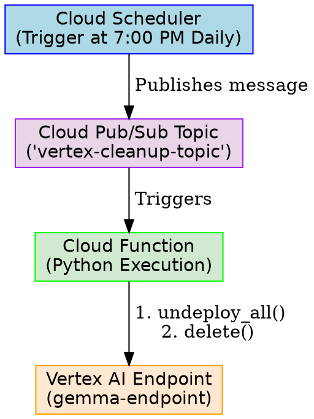

# Vertex AI Automated Endpoint Cleanup & Cost Control

Vertex AI does not natively support automatic idle shutdown or "scale-to-zero" for dedicated online prediction GPU endpoints. However, you can automate resource cleanup using the following three strategies.

---

## Option 1: Scheduled Wall-Clock Shutdown (Cloud Scheduler + Cloud Functions) — *Recommended Best Practice*

This approach ensures expensive GPU resources are undeployed or deleted at a specific wall-clock time (e.g., 7:00 PM every day), even if your local workstation or notebook is disconnected.



### Step 1: Create a Pub/Sub Topic
```bash
gcloud pubsub topics create vertex-cleanup-topic --project="dandye-0324-chronicle"
```

### Step 2: Create a Cloud Function to Undeploy/Delete Endpoints

**`main.py`:**
```python
import base64
from google.cloud import aiplatform

def cleanup_vertex_endpoints(event, context):
    """Cloud Function triggered by Pub/Sub to clean up dev endpoints."""
    aiplatform.init(project="dandye-0324-chronicle", location="us-central1")
    
    endpoints = aiplatform.Endpoint.list()
    cleaned_list = []
    
    for endpoint in endpoints:
        # Match display name to target dev and test Gemma endpoints
        if "gemma" in endpoint.display_name.lower():
            print(f"Undeploying and deleting endpoint: {endpoint.display_name}")
            endpoint.undeploy_all()
            endpoint.delete()
            cleaned_list.append(endpoint.display_name)
            
    print(f"Completed cleanup for: {cleaned_list}")
```

**`requirements.txt`:**
```text
google-cloud-aiplatform>=1.38.0
```

Deploy the Cloud Function:
```bash
gcloud functions deploy cleanup-vertex-endpoints \
    --runtime=python310 \
    --trigger-topic=vertex-cleanup-topic \
    --entry-point=cleanup_vertex_endpoints \
    --region=us-central1 \
    --project="dandye-0324-chronicle"
```

### Step 3: Schedule the Trigger with Cloud Scheduler
Create a Cron job via Cloud Scheduler to trigger cleanup every weekday at 7:00 PM:
```bash
gcloud scheduler jobs create pubsub daily-vertex-cleanup \
    --schedule="0 19 * * 1-5" \
    --topic=vertex-cleanup-topic \
    --message-body="cleanup" \
    --time-zone="America/New_York" \
    --project="dandye-0324-chronicle"
```

---

## Option 2: Python Script with Built-in Timeout (Developer Session Wrapper)

If deploying the endpoint for an interactive testing session, wrap your deployment logic with a timer and a `try...finally` block. This guarantees cleanup on script termination or keyboard interrupt.

```python
import datetime
import time
import vertexai
from vertexai import model_garden

PROJECT_ID = "dandye-0324-chronicle"
REGION = "us-central1"
SHUTDOWN_HOUR = 19  # 7:00 PM local time

vertexai.init(project=PROJECT_ID, location=REGION)

print("Deploying Gemma model to Vertex AI...")
model = model_garden.OpenModel("google/gemma4@gemma-4-12b")
endpoint = model.deploy(
    accept_eula=True,
    machine_type="g2-standard-24",
    accelerator_type="NVIDIA_L4",
    accelerator_count=2,
    serving_container_image_uri="us-docker.pkg.dev/vertex-ai/vertex-vision-model-garden-dockers/pytorch-vllm-serve:20260603_0916_RC01",
    endpoint_display_name="gemma-endpoint-session",
    model_display_name="gemma-4-12b",
    use_dedicated_endpoint=True,
    reservation_affinity_type="NO_RESERVATION",
)

try:
    print(f"Endpoint {endpoint.display_name} is active.")
    print(f"Monitoring time. Script will self-destruct the endpoint at {SHUTDOWN_HOUR}:00.")
    
    while True:
        now = datetime.datetime.now()
        if now.hour >= SHUTDOWN_HOUR:
            print("Target shutdown hour reached. Initiating teardown...")
            break
        # Sleep for 10 minutes before checking again
        time.sleep(600)

finally:
    # Executes even on Ctrl+C or script crash
    print("Safely undeploying resources to stop GPU billing...")
    endpoint.undeploy_all()
    endpoint.delete()
    print("Cleanup complete.")
```

---

## Option 3: Auto-Shutdown on Lack of Activity (Metric-Based)

To shut down strictly based on idle network activity:
1. **Create a Cloud Monitoring Metric Alert**: Configure an alert policy tracking `aiplatform.googleapis.com/prediction/prediction_count` on your endpoint.
2. **Define Idle Threshold**: Trigger the alert when the request count is `0` for more than 1 hour.
3. **Route to Pub/Sub**: Direct the alert notification to the `vertex-cleanup-topic` Pub/Sub topic.
4. **Trigger Cloud Function**: The Cloud Function in Option 1 undeploys the idle endpoint dynamically.
