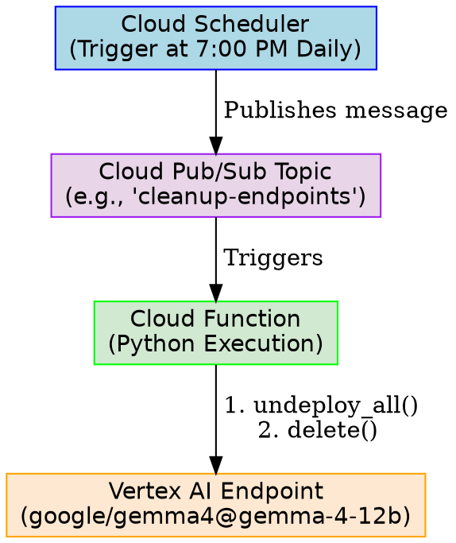

Vertex AI does not natively support automatic idle shutdown or "scale-to-zero" for dedicated online prediction GPU endpoints. However, you can automate resource cleanup using the following three alternative strategies.

---

### Option 1: Scheduled Wall-Clock Shutdown (Cloud Scheduler + Cloud Functions) — *Recommended Best Practice*

This is the most robust approach to ensure expensive GPU resources are deleted at a specific wall-clock time (e.g., 7:00 PM every day), even if your local machine or notebook is closed.



#### Step 1: Create a Pub/Sub Topic
Run the following Google Cloud CLI command to create a trigger topic:
```bash
gcloud pubsub topics create vertex-cleanup-topic --project="dandye-0324-chronicle"
```

#### Step 2: Create a Cloud Function to Delete Endpoints
Deploy a Python Cloud Function that scans for and deletes test endpoints. 

**`main.py`:**
```python
import base64
from google.cloud import aiplatform

def cleanup_vertex_endpoints(event, context):
    """Cloud Function triggered by Pub/Sub to clean up dev endpoints."""
    aiplatform.init(project="dandye-0324-chronicle", location="us-central1")
    
    endpoints = aiplatform.Endpoint.list()
    deleted_list = []
    
    for endpoint in endpoints:
        # Match display name to avoid deleting production resources
        if "mg-one-click-deploy" in endpoint.display_name or "gemma-4" in endpoint.display_name:
            print(f"Undeploying and deleting endpoint: {endpoint.display_name}")
            endpoint.undeploy_all()
            endpoint.delete()
            deleted_list.append(endpoint.display_name)
            
    print(f"Completed deletion for: {deleted_list}")
```

**`requirements.txt`:**
```text
google-cloud-aiplatform>=1.30.0
```

Deploy the function:
```bash
gcloud functions deploy cleanup-vertex-endpoints \
    --runtime=python310 \
    --trigger-topic=vertex-cleanup-topic \
    --entry-point=cleanup_vertex_endpoints \
    --region=us-central1 \
    --project="dandye-0324-chronicle"
```

#### Step 3: Schedule the Trigger with Cloud Scheduler
Create a Cron job via Cloud Scheduler to publish a message to the topic every weekday at 7:00 PM:
```bash
gcloud scheduler jobs create pubsub daily-vertex-cleanup \
    --schedule="0 19 * * 1-5" \
    --topic=vertex-cleanup-topic \
    --message-body="cleanup" \
    --time-zone="America/New_York" \
    --project="dandye-0324-chronicle"
```

---

### Option 2: Python Script with Built-in Timeout (Developer-Centric Solution)

If you only want to deploy the endpoint for a set period of time (or until a specific hour) while working locally, you can wrap your deployment logic in a Python script containing a sleep timer and a `try...finally` block. This guarantees clean-up even if you terminate the script or hit an unexpected failure.

```python
import datetime
import time
import vertexai
from vertexai import model_garden

vertexai.init(project="dandye-0324-chronicle", location="us-central1")

# Define target wall-clock hour for automatic shutdown (e.g., 18 = 6:00 PM local time)
SHUTDOWN_HOUR = 18

print("Deploying Gemma model...")
model = model_garden.OpenModel("google/gemma4@gemma-4-12b")
endpoint = model.deploy(
  accept_eula=True,
  machine_type="g4-standard-48",
  accelerator_type="NVIDIA_RTX_PRO_6000",
  accelerator_count=1,
  serving_container_image_uri="us-docker.pkg.dev/vertex-ai/vertex-vision-model-garden-dockers/pytorch-vllm-serve:20260603_0916_RC01",
  endpoint_display_name="gemma-4-12b-mg-one-click-deploy",
  model_display_name="gemma-4-12b-1787254504403",
  use_dedicated_endpoint=True,
  reservation_affinity_type="NO_RESERVATION",
)

try:
    print(f"Endpoint {endpoint.display_name} is active.")
    print(f"Monitoring time. Script will self-destruct the endpoint at {SHUTDOWN_HOUR}:00.")
    
    while True:
        now = datetime.datetime.now()
        if now.hour >= SHUTDOWN_HOUR:
            print("Target shutdown hour reached. Initiating teardown...")
            break
        # Sleep for 10 minutes before checking the clock again
        time.sleep(600)

finally:
    # This block executes even if you hit Ctrl+C or the loop exits
    print("Safely clean up and undeploying resources...")
    endpoint.undeploy_all()
    endpoint.delete()
    print("Cleanup complete.")
```

---

### Option 3: Auto-Shutdown on Lack of Activity (Metric-Based)

If you want to shut down strictly based on a lack of activity (idle timeout):
1. **Create a Cloud Monitoring Metric Alert**: Configure an alert policy tracking the `aiplatform.googleapis.com/prediction/prediction_count` metric on your endpoint.
2. **Define Idle Threshold**: Trigger the alert when the request count is `0` for more than 1 hour.
3. **Route to Pub/Sub**: Direct the alert notification to a Pub/Sub topic.
4. **Trigger Cloud Function**: Link the Pub/Sub topic to the Cloud Function described in **Option 1** to dynamically undeploy the idle endpoint.

---
